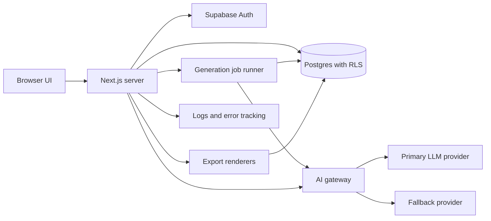

# IDEAPRINT — Refined Product Blueprint

*Make Ideas Buildable.* · Version 2.0, refined and expanded · October 2026 · Status: draft for validation

| At a glance | Summary |
| --- | --- |
| Product | AI-powered product engineering workspace |
| Core promise | Tell IDEAPRINT what you want to build. Get a clear, editable, traceable blueprint for how to build it. |
| Launch audience | Independent developers and early-stage founders |
| Expansion audience | Freelancers and agencies, students, product designers, small teams |
| Platform | Responsive web app (Next.js, Supabase, Vercel) |
| Business model | Freemium SaaS: Free, Pro, Team; Business later |
| Core differentiator | The Blueprint Graph: requirements, components, tasks and tests stay linked, labeled by origin, and honest about uncertainty |
| North Star metric | Weekly active projects: projects with an accepted blueprint and at least one task or document change that week |

## 0. About This Edition

This edition keeps everything that was strong in the original brief (the problem framing, the five-stage journey, the engineering workspace, the honesty principles and the premium visual direction) and sharpens it in seven ways:

1. **A single organizing idea.** The Blueprint Graph (Section 5) turns separate documents into one linked model.
2. **Provenance and trust labels.** Every item says who or what created it and whether it has been verified (Section 5.3).
3. **A multi-pass AI pipeline.** Specialized generation passes plus an independent Critic pass replace one monolithic prompt (Section 7).
4. **Blueprint Health.** A computed, evidence-based quality indicator replaces arbitrary progress numbers (Section 9).
5. **A sharper MVP cut.** A strict must / should / could / won't list with exit criteria for every phase (Section 22).
6. **Implementation-grade detail.** Data model, row-level security, API surface, schemas, threat model and test strategy are specified (Sections 14–19).
7. **Measurable outcomes.** Acceptance criteria use Given / When / Then, and success metrics include AI-quality and guardrail metrics (Sections 23–24).

**Conventions.** Items marked *Hypothesis* are beliefs to be validated with users. Timelines, costs and effort figures are estimates, not commitments. No number in this document is a measured result.

## 1. Executive Summary

IDEAPRINT is an AI-powered product engineering workspace that converts a software idea into an implementation-ready blueprint: problem statement, requirements, MVP scope, architecture, database design, API contracts, tasks, milestones, test plans and risks.

**The problem.** Knowing what to build is different from knowing how to build it. The work between an idea and the first commit is scattered across chat transcripts, documents, diagrams, spreadsheets and task trackers. These drift apart, and generic AI answers sound convincing while lacking acceptance criteria, realistic dependencies and traceability.

**The solution.** A guided workflow (Capture, Define, Design, Plan, Deliver) in which the AI proposes and the human decides. Output is stored as structured, editable records rather than chat text, and every record is linked to what it came from and to what depends on it.

**Why it can win.** Three properties that general chatbots and code generators rarely provide together:

1. **Traceability.** Requirements link to components, tasks and tests, so users can see why each task exists and what is affected when scope changes.
2. **Honesty about uncertainty.** Items are labeled user-provided, AI-proposed or AI-assumed; estimates are ranges; generated tests stay Not Run until someone executes them.
3. **Constraint-aware continuity.** Budget, skills, timeline and hosting preferences shape every recommendation, and accepted decisions persist for the life of the project.

**Who it is for.** Independent developers and early-stage founders first; freelancers, students, designers and small teams next.

**How it earns revenue.** Freemium SaaS with limits on projects and AI generations, richer exports and history in Pro, and collaboration in Team. Prices are set only after cost analysis and user research (Section 20).

**What success looks like.** Initial targets, to be calibrated with real usage and not forecasts: a new user reaches a first accepted blueprint in under 15 minutes; a meaningful share of users who save a blueprint return within seven days to update tasks or documents; users rate the usefulness of generated plans well enough to justify the AI cost of producing them.

## 2. Vision, Mission and Positioning

**Vision.** Become the trusted engineering workspace where anyone with a serious software idea can understand the product, its technical structure and the steps required to build it.

**Mission.** Make software development planning more accessible, organized, technically useful and actionable through AI and structured product engineering workflows.

**Category.** Blueprint-first development: the planning layer that sits between an idea and the first line of code.

**Positioning statement.** For independent developers and early-stage founders who have a software idea but no structured plan, IDEAPRINT is an AI product engineering workspace that turns the idea into an editable, traceable, implementation-ready blueprint. Unlike general AI chat assistants that return unstructured text, or code generators that skip planning, IDEAPRINT keeps requirements, architecture, tasks and tests linked, and is explicit about what is proposed, assumed and verified.

**Ten-second pitch.** Describe your software idea. Get a blueprint you can build from.

**Thirty-second pitch.** IDEAPRINT asks the few questions that matter, then produces requirements, an MVP scope, architecture, a database design, API contracts, tasks and a test plan. Everything is editable and linked, so when your idea changes, you can see what else changes with it. Export it, or keep building inside the workspace.

### 2.1 Brand principles in practice

| Principle | What it means in the product |
| --- | --- |
| Clarity over complexity | One primary action per screen; plain-language labels; advanced detail revealed progressively |
| Engineering over empty promises | Every recommendation carries a rationale and its trade-offs |
| Practical plans over generic AI responses | Outputs are schema-validated, carry IDs and include acceptance criteria |
| Editable decisions over black-box automation | Every AI item can be accepted, edited, rejected or locked |
| Useful functionality over decorative interfaces | Every control performs its advertised action; the app favors density and speed over spectacle |
| Honest estimates over invented certainty | Estimates are ranges with a confidence level; tests stay Not Run until executed |
| Secure architecture over shortcuts | Security requirements are generated from day one; authorization is enforced by default |

### 2.2 Voice and tone

Precise, calm, direct and never hype. The product explains, it does not boast.

| Instead of | Write |
| --- | --- |
| Your app is secure! | No security checks have been run. 6 security test cases are generated and Not Run. |
| This will take 3 weeks. | Estimate: 2–4 weeks for one developer (AI estimate, low confidence). |
| Perfect blueprint generated! | Blueprint generated: 24 requirements, 31 tasks. 3 items need your review. |
| Something went wrong. | The AI response failed validation. Your saved content is unchanged. Retry or edit the request. |

## 3. The Problem

**Root cause.** The gap between a software idea and implementation is a planning gap: the decisions that determine cost, scope and quality are made early, informally and without a shared record.

| Problem | What it looks like | Cost |
| --- | --- | --- |
| Unstructured ideas | A two-line description with no personas, workflows or business rules | Builders start coding on guesses |
| Unclear scope | Every imagined feature is treated as version one | Projects stall or never ship |
| Technical uncertainty | Stack, authentication, schema and hosting chosen by trend or habit | Costly rewrites and security gaps |
| Disconnected workflows | Notes, diagrams, specs and tasks live in different tools | Documents contradict each other over time |
| Weak plans | Fluent AI text with no IDs, acceptance criteria or dependencies | Plans cannot be tracked or tested |
| Limited access to expertise | No product manager or software architect on the team | Early decisions are never reviewed |

### 3.1 How people cope today

| Alternative | Does well | Falls short for this job |
| --- | --- | --- |
| General AI chat assistants | Fast, flexible brainstorming | Unstructured prose; context decays across sessions; nothing is tracked |
| AI app and code generators | Fast path to a running prototype | Often skip requirements, trade-offs and testing; plan and code diverge |
| Task and docs tools (for example Notion, Linear, Jira) | Excellent execution tracking and collaboration | Start from a blank page; no requirement-to-architecture reasoning |
| Diagramming tools | Flexible visual modeling | Diagrams are disconnected from requirements and tasks |
| Static PRD and spec templates | Familiar structure | Manual effort; easy to leave incomplete or inconsistent |
| Consultants and fractional architects | Deep expertise and judgment | Expensive and slow for early-stage budgets |

Examples illustrate categories only. Re-verify the current competitive landscape before external positioning.

### 3.2 Why now (hypotheses)

- Language models can return structured output that is validated against a schema, which makes editable artifacts possible instead of chat text.
- AI-assisted coding lowers the cost of writing code, which makes ambiguous requirements the most expensive remaining bottleneck.
- More people attempt to build software without formal engineering backgrounds. This should be tested through user interviews before it is used in marketing.

## 4. Target Users and Personas

| Segment | Priority | Primary job to be done |
| --- | --- | --- |
| Independent developers | Launch wedge | Turn an idea into a plan they trust before writing code |
| Early-stage founders | Launch wedge | Turn a business concept into a brief a technical team can act on |
| Freelancers and agencies | Second wave | Turn a client request into a scoped, quotable proposal |
| Student developers | Second wave | Learn how complete projects are planned and documented |
| Product designers | Later | Clarify roles, workflows and states before designing screens |
| Small teams | Later | Share one source of truth for specs, tasks and decisions |

The first release deliberately serves the first two rows. This keeps the product focused and creates a natural path toward team collaboration.

### 4.1 Personas

**Amara, the solo developer (primary).** Builds side projects and early products alone. *Job:* “When I have an idea, I want a plan I trust so I can start building without second-guessing my architecture.” *Pains:* over-scoping, choosing a stack by trend, forgetting permission edge cases. *Success:* a trimmed MVP, a schema she agrees with and a task board she can start on the same day. *Key features:* constraint-aware stack recommendation, MVP cut, task board, SQL and Mermaid export.

**Daniel, the non-technical founder (primary).** Has domain expertise and an idea; works with contractors. *Job:* “When I brief developers, I want a document that removes ambiguity so quotes are comparable and delivery is predictable.” *Pains:* vague briefs, scope creep, no way to judge technical proposals. *Success:* requirements he understands and a plain-language explanation of every technical choice. *Key features:* plain-language mode, MVP phasing, read-only share link, Markdown and PDF export.

**Selam, the freelancer or agency lead (secondary, likely early paying user).** *Job:* “When a client sends a rough request, I want a credible scope fast so I can quote accurately.” *Pains:* unpaid discovery work, scope disputes. *Success:* a client-ready scope with milestones and an explicit exclusions list. *Key features:* exclusions list, estimate ranges, reusable templates, client-safe export.

**Students, designers and small teams** are served by the same core workflow. Students need explanation depth and the free tier; designers need roles, flows and states; teams need shared ownership, which arrives with the Team plan after the individual experience is proven.

### 4.2 Non-goals for the first release

Autonomous generation of a full application; compliance-grade documentation for regulated industries; replacing dedicated issue trackers for large teams; guaranteeing that any plan is correct without human review.

## 5. Core Concept: The Blueprint Graph

### 5.1 Why a graph

Most AI planning tools output a document. A document cannot answer: Which tasks implement this requirement? Which tests verify it? What changes if I drop this feature? IDEAPRINT stores the blueprint as typed items connected by typed relationships, called the Blueprint Graph, and renders it through familiar views: documents, boards, tables and diagrams.

### 5.2 Item types and relationships

Every item has a stable, human-readable ID that never changes, even if the item is edited or moved.

| Item type | ID prefix | Purpose |
| --- | --- | --- |
| Problem | PRB | The pain being solved |
| Persona | PER | A user archetype or role |
| Goal | GOL | A measurable outcome |
| Functional requirement | FR | What the system must do |
| Non-functional requirement | NFR | Quality attributes: performance, security, accessibility and so on |
| User story | US | A user outcome with acceptance criteria |
| Component | CMP | An architecture element: service, interface, data store, integration |
| Entity | ENT | A database table or aggregate |
| Endpoint | API | An API operation |
| Task | TSK | A unit of implementation work |
| Milestone | MS | A delivery checkpoint |
| Test case | TC | A verification procedure |
| Decision | DEC | A recorded choice with alternatives and rationale |
| Risk | RSK | A potential problem with a mitigation |
| Assumption | ASM | A belief used where facts are missing |
| Open question | Q | Unresolved information that affects the plan |

| Relationship | Meaning | Example |
| --- | --- | --- |
| derives\_from | The source was derived from the target | US-004 derives\_from FR-010 |
| satisfies | The component or decision satisfies the requirement | CMP-002 satisfies NFR-003 |
| implements | The task implements the requirement or story | TSK-031 implements US-004 |
| verifies | The test verifies the requirement or story | TC-017 verifies FR-010 |
| depends\_on | The source cannot complete before the target | TSK-032 depends\_on TSK-031 |
| mitigates | The task, decision or component reduces the risk | DEC-005 mitigates RSK-002 |
| motivated\_by | The decision was made because of the target | DEC-005 motivated\_by NFR-003 |
| supersedes | The newer item replaces the older one | DEC-009 supersedes DEC-004 |

### 5.3 Provenance and trust labels

Every item carries the following attributes, and the interface shows them.

| Attribute | Values | Purpose |
| --- | --- | --- |
| origin | user, ai\_proposed, ai\_assumed, imported | Who or what created the item |
| status | draft, proposed, accepted, rejected, superseded | Review state |
| confidence | low, medium, high, plus a one-line reason (AI items only) | Shows where to look first |
| locked | true or false | Locked items are never overwritten by regeneration |
| verification | not\_run, passed, failed, blocked (test cases only), with who and when | Separates plans from evidence |

**Trust rules**

- User-provided constraints are always displayed as such and always outrank AI recommendations.
- Only accepted items feed downstream generation and default exports. Proposed items appear in an export only if the user opts in, and are visibly labeled.
- Regeneration creates a proposed revision beside the current item as a diff. It never silently overwrites.
- A generated test case is Not Run until a person or an integrated test system records a result.
- The product never states that code is secure, that a deployment is complete or that a test passed without recorded evidence.

### 5.4 What the graph enables

- **Impact analysis.** Editing or removing a requirement lists every affected story, component, task and test before the change is saved.
- **Coverage views.** Instantly find requirements with no task, tasks with no requirement and must-have requirements with no test.
- **Consistent exports.** Markdown, JSON, SQL, Mermaid and OpenAPI outputs are all rendered from the same saved records.
- **Efficient AI context.** Generation receives a compact slice of the accepted graph instead of a long chat history, which improves relevance and lowers cost.
- **Reliable history.** Changes are recorded per item, so decisions can be traced and reversed.

## 6. The Product Lifecycle and User Journey

### 6.1 Five stages with exit gates

| Stage | Goal | Main outputs | Exit gate |
| --- | --- | --- | --- |
| 1. Capture | Understand the idea | Problem statement, goals, audience, constraints, open questions | Problem and audience accepted; blocking questions answered or converted into assumptions |
| 2. Define | Decide what the product is | Personas, FR and NFR, user stories, MVP phasing, exclusions | MVP scope accepted; every must-have requirement has acceptance criteria |
| 3. Design | Decide how it works | Architecture, entities, API contracts, stack decisions | Every must-have requirement is satisfied by a component; schema and API reviewed |
| 4. Plan | Decide how to build it | Tasks, milestones, dependencies, estimate ranges, test plan | Every must-have requirement has at least one task and one test case |
| 5. Deliver | Prepare to ship | Security checklist, deployment checklist, documentation, launch readiness | Checklist items assigned; open high-severity risks acknowledged |

Gates are advisory. Users may proceed with warnings, and any override is recorded in the activity log.

### 6.2 The journey in detail

**Step 1. Create a project (Idea Canvas).** One large, friendly text area: “Describe what you want to build, in your own words.” Optional fields: name, audience, objectives. Starter templates (SaaS, marketplace, internal tool, mobile app, API product, AI tool) pre-fill example prompts but never lock the user into a questionnaire.

**Step 2. Clarify the idea.** The AI asks only questions whose answers would materially change scope, architecture or cost.

- At most five questions per round and at most three rounds.
- Questions are ranked by impact; each shows why it matters, offers suggested answers as quick-select options and includes Skip and assume.
- Every skipped question becomes a visible Assumption (ASM) that can be revised later.

Example for a school management platform:

| Question | Why it matters | Assumed if skipped |
| --- | --- | --- |
| Do students have individual accounts? | Determines the authentication model and privacy obligations for minors | Staff-only accounts; students and guardians excluded from the MVP |
| Are payments required? | Adds provider integration, reconciliation and compliance scope | No payments in the MVP; fees tracked manually |
| Which roles can view grades? | Drives authorization rules and the data model | Teachers and administrators only |
| One school or many? | Multi-tenancy affects every table and access policy | One school; the design leaves room for tenant separation |

**Step 3. Configure constraints.** Each constraint is stored with the label *user-provided* and is never silently changed by the AI.

| Constraint | Examples |
| --- | --- |
| Application type | Web app, mobile app, desktop, SaaS, API |
| Languages and frameworks | Preferred stack, or no preference |
| Developer skills | Self-rated by area: frontend, backend, data, DevOps |
| Hosting and infrastructure | Serverless, managed platform, self-hosted |
| Budget band | Monthly infrastructure and tooling ceiling |
| Delivery window | Target date or number of weeks |
| Integrations | Payments, email, maps, identity providers |
| Must-have and excluded features | Explicit inclusions and exclusions for version one |
| Compliance and region | Data residency, accessibility level, age restrictions |
| Team size | Solo, two to five, larger |

**Step 4. Generate the blueprint.** Generation runs as a staged, streamed process (analysis, requirements, scope, architecture, data, API, tasks, tests, risks, Critic review) with per-stage progress and a cancel option. A failed stage can be retried without losing completed stages. Results arrive as *proposed* items on a review screen: grouped by artifact, with accept, edit and reject per item, rationale and confidence beside each, bulk accept per group and Critic findings at the top. Nothing becomes part of the project until it is accepted.

**Step 5. Open the engineering workspace.** The accepted blueprint populates Overview, Blueprint, Architecture, Database, API, Tasks, Roadmap, Testing and Decisions.

**Step 6. Execute and update.** Users edit requirements, move tasks, adjust milestones and log decisions as the build evolves. Edits to an accepted item show an impact list first. Progress, coverage and Blueprint Health recalculate from saved records.

**Step 7. Export and share.** Users export documents in portable formats and, when collaboration is enabled, share read-only views or invite collaborators with explicit roles.

## 7. The AI Product Architect

The AI Product Architect is the intelligence layer of IDEAPRINT. It must do more than expand a sentence into a long description. It produces structured artifacts that a developer can inspect, revise and implement.

### 7.1 Design principles

- **Structured, not conversational.** Every output is a typed record validated against a schema before it is saved.
- **Staged, not monolithic.** Specialized passes with narrow inputs are more reliable and easier to evaluate than one giant prompt.
- **Grounded in accepted context.** Each pass reads the accepted Blueprint Graph and the user's constraints, not the whole chat history.
- **Ask, don't invent.** Missing facts become targeted questions or visible assumptions.
- **Explain trade-offs.** Recommendations name the alternatives considered and what would change the recommendation.
- **Human final say.** Nothing becomes part of the project until a person accepts it.

### 7.2 The generation pipeline

| Pass | Role | Reads | Produces (all as proposed items) |
| --- | --- | --- | --- |
| 1. Interviewer | Finds blocking gaps | Idea, constraints | Ranked clarifying questions; assumptions for skipped questions |
| 2. Analyst | Frames the problem | Idea, answers | Executive summary, problem statement, personas, goals, success criteria |
| 3. Requirements Engineer | Specifies behavior | Accepted analysis | FR, NFR and user stories with IDs, priorities and acceptance criteria |
| 4. Scoper | Cuts the MVP | Requirements, constraints | MVP, post-MVP, future and excluded sets, each with a rationale |
| 5. Architect | Designs the system | Accepted scope, constraints | Stack options and recommendation, components, data flows, entities, endpoints |
| 6. Planner | Plans execution | Accepted design | Milestones, tasks, dependencies, effort ranges |
| 7. QA Strategist | Plans verification | Requirements, design | Test plan and test cases (all Not Run), security and accessibility checks |
| 8. Critic | Reviews independently | Entire proposed graph | Findings: gaps, contradictions, over-scope, unsupported claims, missing NFRs, each with severity |

Passes run in order, each receiving only the context it needs. The Critic is deliberately separate from the passes it reviews, because a model reviewing its own output in the same step tends to approve it.

### 7.3 Quality standards for generated items

Every requirement must be atomic (one behavior), testable, free of implementation detail and free of unmeasured adjectives such as fast, easy or secure. Every requirement carries an ID, a priority (Must, Should, Could, Won't), a category, a rationale, acceptance criteria and a link to the item it derives from.

| Weak (rejected by the Critic) | Strong |
| --- | --- |
| The app should be fast and secure. | NFR-003 (Must): Project pages load in under 2 seconds for 95% of requests with up to 500 items on a typical broadband connection. Acceptance: verified by a recorded performance test run. |
| Users can manage tasks. | FR-014 (Must): An authenticated project member can create, edit, move and delete tasks. Acceptance: a status change persists after reload; deletion requires confirmation. |
| Data is protected. | NFR-004 (Must): Project data is readable only by its owner or authorized members, enforced at the database level. Acceptance: a request using another user's credentials and a known project ID returns no data. |

### 7.4 Technology recommendations

The Architect always presents two or three viable options with the same criteria, followed by a single recommendation and the condition that would change it. Technologies the user selected are marked *user-selected* and are never overridden: the AI designs within them and flags risks instead.

| Criterion | Option A | Option B | Option C |
| --- | --- | --- | --- |
| Fit with stated skills | Strong | Moderate | Weak |
| Time to MVP | Short | Medium | Long |
| Hosting cost at launch | Low | Low | Medium |
| Scalability headroom | Good | Good | Very good |
| Operational burden | Low (managed services) | Medium | High |
| Ecosystem and hiring | Large | Large | Medium |

The table above shows the format only. Real recommendations name concrete stacks, give a one-line rationale per cell and end with: *Recommended: Option A, because the stated constraints are a solo developer, a budget under the stated ceiling and a six-week window. Reconsider if the project needs heavy background processing.*

### 7.5 Estimation

- Estimates are ranges (optimistic, likely, pessimistic) in effort-days for a stated reference profile, such as one developer at the self-rated skill level.
- Each estimate shows its confidence and the assumptions behind it.
- Calendar dates are never presented as guarantees. The roadmap shows sequences and ranges.
- Where users log actual durations, a later release can compare estimates with actuals to improve calibration.

### 7.6 Interaction modes and regeneration

- **Guided** (default): clarifying questions, staged generation, item-by-item review.
- **Quick:** one prompt in, a full proposed blueprint out, with more visible assumptions.
- **Plain language:** the same content explained without jargon, for non-technical founders.
- **Expert:** terse output with more technical depth.
- **Regenerate a section with an instruction** (for example: make this cheaper, assume mobile-first). The result is a proposed revision shown as a diff beside the current item. Locked and user-edited items are never touched unless the user explicitly includes them.

### 7.7 Failure behavior

1. A response that fails schema validation triggers one automatic repair attempt that includes the validation errors.
2. If repair fails, the pass is marked failed, existing content is untouched and the user sees a clear message with Retry and Edit request actions.
3. Only validated items are saved, and only as proposed. Malformed data is never persisted.
4. If a provider is unavailable, a configured fallback provider is used; otherwise the job is paused and can be resumed.
5. Quota and rate-limit states are shown with the remaining allowance before the user starts a generation.

## 8. The Engineering Workspace

Each project has a dedicated workspace. The workspace is a productivity tool first: dense, fast and consistent.

### 8.1 Overview

Shows the current lifecycle stage, Blueprint Health (Section 9), progress calculated from saved tasks and milestones, the next three unblocked tasks, outstanding decisions and open questions, unmitigated high risks and recent activity. Progress is the share of tasks in Done, optionally weighted by effort, and is shown per milestone and overall. It is never an arbitrary percentage.

### 8.2 Blueprint

The home of the executive summary, problem statement, personas, requirements, user stories, scope phases, assumptions and open questions. Items are edited inline in a structured editor with rich text for descriptions. Each item shows its ID, provenance badge, status and links. Users can regenerate a selected section, accept or reject revisions and (in phase two) browse version history.

### 8.3 Architecture Studio

Renders system diagrams from component and relationship records, so diagrams cannot drift from the documented design. Views: system context, components, data flow and deployment. A component inspector shows description, technology, responsibilities and the requirements the component satisfies. Export Mermaid source and image. The first release renders Mermaid; an interactive node editor (React Flow or similar) follows later.

### 8.4 Database Designer

Presents entities, fields, types, constraints, indexes and relationships, with an entity-relationship diagram. Exports a PostgreSQL schema proposal and suggested row-level security policies. Every schema is labeled *proposed design*. IDEAPRINT never connects to, or modifies, a user's production database without explicit authorization, and the first release does not connect to user databases at all.

### 8.5 API Designer

Documents endpoints, methods, authentication requirements, parameters, validation rules, response schemas and expected errors. Exports OpenAPI 3.1 when definitions are complete. Consistency checks compare endpoints with entities and requirements.

### 8.6 Task Manager

| Capability | Detail |
| --- | --- |
| Columns | Backlog, Todo, In Progress, Review, Done |
| Fields | Title, description, priority, status, assignee (when collaboration is enabled), dependencies, acceptance criteria checklist, linked requirement, milestone, effort estimate range, timestamps |
| Views | Board and list; search, filter by status, priority, milestone and requirement; sort; bulk edit |
| Dependencies | A task with unfinished prerequisites is shown as Blocked and cannot move to Done unless the user deliberately overrides, which is recorded |
| Readiness | A task is Ready when all prerequisites are Done; the Overview surfaces Ready tasks first |
| Accessibility | Every drag action has a keyboard and menu alternative |

AI-generated effort values are labeled estimates, never delivery promises.

### 8.7 Roadmap

Shows phases, milestones, dependencies and execution progress. The roadmap adapts to the project instead of forcing a template. A typical sequence is Foundation, Core product, Data and integrations, Testing and refinement, Deployment. A critical-path highlight arrives in phase two.

### 8.8 Testing Lab

Organizes test plans and cases by category: functional, edge conditions, permissions, security, accessibility and reliability. Each case has an ID, objective, preconditions, steps, expected result, linked requirement and status: Not Run, Passed, Failed or Blocked. Results are recorded with who, when and notes. A generated case remains Not Run until executed by a person or an integrated test system. Later releases can import results from automated test runs.

### 8.9 Decisions

An architecture decision log: context, decision, alternatives considered, consequences, status (proposed, accepted, superseded) and links to the requirements that motivated it. Decisions can supersede earlier decisions without deleting history.

### 8.10 Activity and settings

The activity timeline records meaningful events: project creation, document edits, task moves, milestone completion, accepted generations and exports. It never stores private model outputs, access tokens or sensitive content. Settings cover project metadata, collaboration, export options, archive and delete. Destructive actions require a typed confirmation.

## 9. Traceability, Consistency and Blueprint Health

### 9.1 Coverage metrics

All metrics are computed from saved records.

| Metric | Definition |
| --- | --- |
| Requirement-to-task coverage | Accepted Must and Should requirements with at least one linked task, divided by all accepted Must and Should requirements |
| Requirement-to-test coverage | The same ratio for linked test cases |
| Acceptance-criteria completeness | Requirements and stories that have at least one criterion |
| Orphan tasks | Tasks with no linked requirement or story |
| Blocking open questions | Open questions marked as blocking |
| Unmitigated high risks | High-severity risks with no linked mitigation |
| Dependency integrity | Cycles, and tasks marked Done while prerequisites are not |
| Verification state | Counts of Passed, Failed, Blocked and Not Run, always shown separately and never blended into one percentage |

### 9.2 Consistency checks

Deterministic rules run on every save, with no AI involved: an endpoint references a missing entity; a component satisfies no requirement; a removed requirement still has tasks; a milestone has no tasks; a dependency cycle exists; a Must requirement has no acceptance criteria; an entity is unused by any endpoint (warning). An optional Critic pass adds semantic review such as contradictions and over-scope.

### 9.3 Blueprint Health presentation

Blueprint Health is shown as a transparent checklist with counts, not a single vanity score. An optional summary band (Needs work, Reasonable, Strong) is derived by a published rule visible on hover. Health describes the completeness and consistency of the plan. It does not predict product success, and the product never labels a project secure or launch-ready without recorded evidence.

## 10. Exports, Imports and Integrations

| Export | Contents | Phase |
| --- | --- | --- |
| Markdown | Full blueprint or any single document | MVP |
| JSON | Structured project data with a documented, versioned schema (schemaVersion field) | MVP |
| Mermaid | Architecture and entity-relationship diagrams | 2 |
| SQL | PostgreSQL schema proposal with warnings and setup notes | 2 |
| OpenAPI | OpenAPI 3.1 specification | 2 |
| CSV | Tasks, requirements, test cases | 2 |
| Build Pack | A bundle (README, requirements, architecture, schema, tasks, tests) formatted so AI coding assistants and developers can start from it | 2 |
| PDF | Polished proposal or specification | Later |
| Read-only share link | Revocable view of selected documents | Later |

**Export rules**

- Exports reflect actual saved, accepted content. Proposed items are included only when the user opts in, and are labeled.
- Every export begins with project name, export time, schema version and a provenance legend.
- No invented test results, completion figures or placeholder data presented as real.
- Secrets and internal identifiers are never included.
- JSON import (backup and restore) arrives in phase two.

**Integration roadmap.** Issue-tracker export (GitHub Issues, Linear, Jira) and repository setup via narrowly scoped OAuth come after the core product proves its value. Direct code generation and repository modification are separate, carefully scoped capabilities and are never simulated.

## 11. Website and Application Structure

### 11.1 Public routes

| Route | Purpose |
| --- | --- |
| / | Landing page |
| /product | Product capabilities |
| /how-it-works | The journey from idea to delivery |
| /use-cases | Workflows by audience |
| /examples | Read-only sample blueprints, clearly labeled as examples |
| /pricing | Plans and limits, once finalized |
| /docs | Onboarding, guides, export schema reference |
| /changelog | Release notes |
| /sign-in, /sign-up | Authentication |
| /privacy, /terms | Legal and data handling, required before public launch |

### 11.2 Authenticated routes

| Route | Purpose |
| --- | --- |
| /dashboard | Active projects, recent work, pending tasks, create-project action |
| /projects/new | Idea Canvas and constraints |
| /projects/\[projectId\] | Overview and Blueprint Health |
| /projects/\[projectId\]/blueprint | Requirements, scope, stories, specifications |
| /projects/\[projectId\]/architecture | System architecture |
| /projects/\[projectId\]/database | Entities and schema proposal |
| /projects/\[projectId\]/api | Endpoint contracts |
| /projects/\[projectId\]/tasks | Task board |
| /projects/\[projectId\]/roadmap | Milestones and phases |
| /projects/\[projectId\]/testing | Test plans and execution status |
| /projects/\[projectId\]/decisions | Decision log |
| /projects/\[projectId\]/activity | Activity timeline |
| /projects/\[projectId\]/exports | Export center |
| /projects/\[projectId\]/settings | Project settings |
| /settings | Profile, preferences, usage and plan |
| /admin | Administration; authorization enforced server-side |

A project the user cannot access returns the same not-found response as a project that does not exist, so identifiers reveal nothing.

### 11.3 Application shell

Left sidebar (project switcher and workspace sections), top bar (command palette on Ctrl or Cmd plus K, quota indicator, account menu), main content and a right-hand inspector drawer that shows any selected item with its provenance, links and history. On mobile the sidebar collapses to a bottom navigation bar and the inspector opens as a full-screen sheet.

## 12. Landing Page Direction

The public site may be cinematic and expressive. The application must stay usable and information-dense. The two share one design system (Section 13) so the transition feels continuous.

**Hero.** Headline: **MAKE IDEAS BUILDABLE.** Supporting text: Turn your software ideas into structured requirements, technical architecture, development tasks, and actionable product blueprints — all in one intelligent workspace. Primary action: **Build Your Blueprint.** Secondary action: **Explore the Platform.**

**Hero visual.** A plain-language idea sentence on the left resolves, as the visitor scrolls, into a grayscale graph of linked nodes (requirements, components, entities, tasks), with violet reserved for AI-proposed nodes. It is drawn with SVG or canvas from real item types, not stock imagery.

**Scroll story.** Six scenes: the idea; the problem statement; requirements gaining IDs; architecture and database connecting; tasks and milestones forming a board; a launch checklist whose items are honestly still unchecked.

| # | Section | Purpose |
| --- | --- | --- |
| 1 | Hero | State the promise and offer two clear actions |
| 2 | Problem | Name the planning gap in the visitor's own terms |
| 3 | Product introduction | Explain blueprint-first development in one screen |
| 4 | How it works | Five stages with gates |
| 5 | Interactive workspace preview | A real or clearly labeled prototype of the workspace |
| 6 | Core capabilities | Blueprint Graph, provenance labels, constraint-aware planning, exports |
| 7 | Use cases | Developers, founders, freelancers, students, teams |
| 8 | Examples | Sample blueprints from real generations |
| 9 | Pricing | Shown only when plans are finalized |
| 10 | FAQ | Answer trust and capability questions |
| 11 | Final call to action | Repeat the primary action |
| 12 | Footer | Product, docs, legal, contact |

**Integrity rules.** No fabricated logos, testimonials, statistics or user counts. Any interface preview that is not the live product is labeled Prototype preview until it is. Examples must come from actual generated output.

**Performance and accessibility targets.** Core Web Vitals in the good range on a mid-range mobile device (LCP 2.5 s or less, INP 200 ms or less, CLS 0.1 or less); WCAG 2.2 AA; full reduced-motion support; scroll effects as progressive enhancement; consented analytics; complete metadata for search and social sharing.

**Draft FAQ** (to be verified against the shipped product and legal review):

| Question | Draft answer |
| --- | --- |
| How is this different from a general AI chat? | Output is structured, editable and linked, so requirements, tasks and tests stay connected and your accepted decisions persist. |
| Does IDEAPRINT write my code? | Not in the first release. It prepares the plan, schema, API contracts and tasks you build from. |
| Can I change what the AI produces? | Yes. Every item can be accepted, edited, rejected or locked, and regeneration never overwrites locked items. |
| Who owns my projects? | You do. You can export your data at any time. |
| Are the estimates guaranteed? | No. They are ranges with a stated confidence and assumptions. |

## 13. Design System

### 13.1 Two registers, one system

**Cinematic** (public site): oversized type, generous spacing, restrained parallax. **Productive** (application): compact density, predictable layout, minimal decoration. Both use the same tokens.

### 13.2 Color tokens

| Token | Value | Use |
| --- | --- | --- |
| bg-base | #0A0A0B | Page background (obsidian) |
| bg-raised | #111113 | Panels (charcoal) |
| surface | #18181B | Cards and inputs (graphite) |
| surface-hover | #1F1F23 | Hover state |
| border | #2A2A2F | Default borders |
| border-strong | #3A3A41 | Emphasis and focus containers |
| text-primary | #F4F4F5 | Headings and body (off-white) |
| text-secondary | #A1A1AA | Supporting text |
| text-muted | #71717A | Non-essential hints |
| accent-violet | #7C3AED | AI and primary actions (fill, with white text) |
| accent-violet-text | #A78BFA | Violet text and icons on dark backgrounds |
| accent-cyan | #5EC8DA | Secondary accent, used sparingly |
| success | #34D399 | Verified, Passed, Done |
| warning | #FBBF24 | Assumed, At risk, Blocked |
| danger | #F87171 | Failed, destructive actions |

All text and control pairings must be verified against WCAG 2.2 AA (4.5:1 for text, 3:1 for large text and interface components) during implementation. A light theme is a later option; define all colors as tokens so it can be added without rework.

**Provenance badges** use icon plus text, never color alone: User (outlined), AI proposed (violet), AI assumed (amber, dashed outline), Verified (green, check).

### 13.3 Typography, spacing and shape

- **Typefaces (self-hosted, open license):** a contemporary geometric or grotesque sans for headings (for example Space Grotesk or Geist), a neutral sans for body (Inter or Geist Sans) and a monospace for IDs and code (Geist Mono or JetBrains Mono).
- **Scale:** display 72–128 px fluid (landing only), H1 40, H2 28, H3 20, body 15–16, small 13, caption 12. Application body text is never below 14 px.
- **Spacing:** 4 px base unit (4, 8, 12, 16, 24, 32, 48, 64, 96).
- **Radius:** 6, 10 and 16 px. In dark interfaces, prefer borders over shadows.
- **Focus ring:** 2 px violet with 2 px offset on every interactive element.

### 13.4 Motion

Durations 120, 200 and 360 ms; ease-out curve; reveals are short fades and small translations. Parallax is limited to hero imagery. With prefers-reduced-motion, parallax and large translations are removed and transitions become simple fades. No information is conveyed by motion alone.

### 13.5 Component inventory

Button (primary, secondary, ghost, destructive; hover, focus-visible, active, disabled and loading states), input, select and combobox, tabs, modal, drawer, card, sortable table, badge (provenance, status, priority), tooltip, toast, dropdown, command palette, empty state, skeleton loader, confirmation dialog with typed confirmation, stepper, progress indicator. Application-specific components: ItemChip (ID plus title, links to the inspector), ProvenanceBadge, DiffViewer, ImpactList, QuotaMeter and KanbanCard.

### 13.6 Accessibility standards

WCAG 2.2 AA target; every function operable by keyboard (drag and drop always has an alternative); managed focus in modals and drawers; ARIA live regions announce generation progress; every control has an accessible name; touch targets of at least 44 px on mobile; testing with a screen reader before launch.

## 14. Technical Architecture

### 14.1 Stack and rationale

These are recommendations for the first release. Every external service sits behind an adapter so it can be replaced without rewriting the application.

| Layer | Choice | Rationale |
| --- | --- | --- |
| Frontend | Next.js (App Router), React, TypeScript in strict mode | Server components for fast reads, one language across the stack, strong ecosystem |
| UI | Tailwind CSS, shadcn/ui, Lucide icons | Accessible primitives and consistent styling that the design tokens can drive |
| Validation | Zod schemas shared by client and server | One source of truth for request, form and AI output shapes |
| Client data | Server components for reads; a query library (TanStack Query or SWR) for mutations and caching | Predictable cache invalidation after edits |
| Diagrams | Mermaid rendered client-side in strict mode; React Flow later | Portable source now, interactive editing when justified |
| Database and auth | Supabase: PostgreSQL, Auth, Row Level Security | Relational model, built-in authorization at the data layer, managed operations |
| AI | Server-side AI gateway with provider adapters | Provider independence, central cost and safety controls |
| Long-running work | Resumable generation jobs: streamed route handlers first, a durable queue when runs exceed function time limits | Generation takes longer than a normal request and must survive disconnects |
| Hosting | Vercel with a preview environment for every pull request | Fast feedback and safe review |
| Quality tooling | Vitest, Playwright, axe, SQL tests for RLS, GitHub Actions | Covers logic, journeys, accessibility and authorization |
| Observability | Error tracking, structured logs, consented product analytics | Find failures without collecting project content |

### 14.2 System overview

Mermaid source (renders in the Architecture Studio once implemented):



### 14.3 Code organization and boundaries

```
src/
  app/            routes, layouts, server actions
  components/     UI primitives and shared components
  features/       projects, blueprint, tasks, testing, exports, billing
  server/
    ai/           gateway, providers, prompts, schemas, evaluators
    db/           repositories and query helpers
    auth/         session and authorization helpers
    exports/      pure renderers: markdown, json, sql, openapi, mermaid
  lib/            shared utilities and constants
supabase/migrations/   versioned SQL migrations
tests/                 unit, integration, rls, e2e
```

- The browser never calls an AI provider. All model calls go through the gateway.
- Every sensitive operation is authorized in the server layer and again by RLS.
- Export renderers are pure functions from saved records to text, which makes them easy to test and guarantees exports match stored data.
- Features own their Zod schemas and share them with the server.

### 14.4 Generation job lifecycle

1. The client starts a generation. The server checks the quota, reserves usage and creates a job row.
2. For each pass, the server assembles a context slice from accepted items and constraints, calls the gateway with the pass schema, validates the result (schema, then semantic checks) and stores valid items as proposed.
3. Progress events stream to the client. If the connection drops, the job continues and the client resumes from stored state.
4. When all passes finish, the job moves to awaiting review. Accepted items become part of the project; usage is finalized.
5. Jobs are idempotent (idempotency key), cancellable and time-limited. States: queued, running, awaiting\_review, completed, failed, canceled.

## 15. Data Model

### 15.1 Entities

The MVP creates only the tables its features need. Later tables are listed so the design stays coherent.

| Table | Purpose | Key fields |
| --- | --- | --- |
| profiles | User profile and preferences | id (references auth user), display\_name, avatar\_path, preferences, plan\_id |
| projects | The project container | owner\_id, name, description, type, status, stage, stack, constraints, deleted\_at |
| documents | Narrative artifacts (summary, problem statement, test plan) | project\_id, type, title, content, status, version |
| requirements | FR and NFR | project\_id, display\_id, kind, statement, priority, category, acceptance\_criteria, provenance columns |
| user\_stories | Stories with criteria | project\_id, display\_id, persona, statement, acceptance\_criteria, provenance columns |
| milestones | Delivery checkpoints | project\_id, title, due\_date, status |
| tasks | Implementation work | project\_id, display\_id, title, status, priority, milestone\_id, effort\_min\_days, effort\_max\_days, provenance columns |
| task\_dependencies | Prerequisites | task\_id, depends\_on\_task\_id |
| test\_cases | Verification procedures | project\_id, display\_id, category, objective, preconditions, steps, expected\_result |
| test\_runs | Recorded executions | test\_case\_id, status, executed\_by, executed\_at, notes |
| decisions | Decision log | project\_id, display\_id, context, decision, alternatives, consequences, status |
| risks, assumptions, open\_questions | Planning uncertainty | project\_id, display\_id, description, severity or blocking flag, mitigation |
| item\_links | Blueprint Graph edges | project\_id, source\_type, source\_id, relation, target\_type, target\_id |
| activity\_events | Timeline | project\_id, actor\_id, event\_type, subject\_type, subject\_id, summary, created\_at |
| ai\_jobs | Generation runs | project\_id, user\_id, kind, status, passes, error\_code, prompt\_version |
| ai\_usage | Metering | user\_id, job\_id, provider, model, input\_tokens, output\_tokens, cost\_estimate, validation\_status |
| Phase 2 | components, entities, api\_endpoints, item\_versions | Architecture, schema and API records; per-item history |
| Later | project\_members, subscriptions, plans | Collaboration and billing |

**Provenance columns** on every AI-touchable table: origin, status, confidence, confidence\_reason, locked.

### 15.2 Conventions

- UUID primary keys, created\_at and updated\_at on every table, an updated\_at trigger and an integer version for optimistic concurrency.
- Human-readable display\_id (FR-014) unique per project, allocated inside a transaction from a per-project counter.
- Text columns with check constraints instead of native enums, which makes migrations easier.
- Children cascade-delete with the project. Projects use soft delete (deleted\_at) and are purged after a retention period set in policy.
- item\_links is polymorphic, so referential integrity is enforced by a validation trigger and repository code rather than by foreign keys (see Decision DEC-004).
- Indexes on every foreign key and on common filters such as (project\_id, status).
- ai\_jobs and ai\_usage store metadata only. Prompts and model responses are not retained by default.

### 15.3 Illustrative SQL excerpt

The final schema must match the implemented features. This excerpt shows the pattern, including row-level security.

```sql
create table projects (
  id uuid primary key default gen_random_uuid(),
  owner_id uuid not null references auth.users(id) on delete cascade,
  name text not null check (char_length(name) between 1 and 120),
  description text,
  type text not null default 'web_app',
  status text not null default 'active' check (status in ('active','archived')),
  stage text not null default 'capture'
    check (stage in ('capture','define','design','plan','deliver')),
  constraints jsonb not null default '{}'::jsonb,
  created_at timestamptz not null default now(),
  updated_at timestamptz not null default now(),
  deleted_at timestamptz
);

-- milestones table omitted from this excerpt
create table tasks (
  id uuid primary key default gen_random_uuid(),
  project_id uuid not null references projects(id) on delete cascade,
  display_id text not null,
  title text not null,
  status text not null default 'backlog'
    check (status in ('backlog','todo','in_progress','review','done')),
  priority text not null default 'medium'
    check (priority in ('low','medium','high','urgent')),
  origin text not null default 'user'
    check (origin in ('user','ai_proposed','ai_assumed','imported')),
  milestone_id uuid references milestones(id) on delete set null,
  version int not null default 1,
  created_at timestamptz not null default now(),
  updated_at timestamptz not null default now(),
  unique (project_id, display_id)
);
create index on tasks (project_id, status);

alter table projects enable row level security;
alter table tasks enable row level security;

create function has_project_access(pid uuid) returns boolean
language sql stable security definer set search_path = public as $$
  select exists (
    select 1 from projects p
    where p.id = pid and p.owner_id = (select auth.uid()) and p.deleted_at is null
  );
$$;

create policy projects_owner on projects
  for all using (owner_id = (select auth.uid()))
  with check (owner_id = (select auth.uid()));

create policy tasks_by_project on tasks
  for all using (has_project_access(project_id))
  with check (has_project_access(project_id));
```

Because every child table calls has\_project\_access, adding collaborators later means changing one function and adding project\_members, not rewriting every policy.

## 16. API Surface

The application API is served by Next.js route handlers and server actions. All inputs are validated with Zod, and all responses use a consistent error shape: an error object with code, message and optional details.

| Endpoint | Purpose |
| --- | --- |
| POST /api/projects; GET /api/projects | Create a project; list the user's projects |
| GET, PATCH, DELETE /api/projects/:id | Read, update, soft-delete (confirmed) |
| POST /api/projects/:id/clarify | Generate ranked clarifying questions |
| POST /api/projects/:id/generate | Start a blueprint generation job and return a job ID |
| GET /api/jobs/:jobId/events | Stream progress events (server-sent events) |
| POST /api/jobs/:jobId/cancel | Cancel a running job |
| POST /api/jobs/:jobId/review | Accept or reject proposed items in bulk |
| POST /api/projects/:id/items/:type/:itemId/regenerate | Regenerate one item or section with an instruction |
| CRUD /api/projects/:id/requirements, stories, tasks, milestones, test-cases, decisions | Manage items |
| PATCH /api/projects/:id/tasks/:taskId/status | Move a task, enforcing dependency rules |
| POST /api/projects/:id/test-cases/:testId/runs | Record a test result |
| GET /api/projects/:id/health | Computed Blueprint Health |
| GET /api/projects/:id/impact?item=FR-010 | Impact list for an item |
| GET /api/projects/:id/export?format=markdown or json&include=proposed | Export saved content |
| GET /api/me/usage | Plan, quota and usage |

**Conventions.** Cursor pagination; idempotency keys on requests that consume AI quota; optimistic concurrency through the version field (a stale write returns a conflict); rate-limit headers; the same 404 for missing and unauthorized resources.

**Error codes.** validation\_failed, unauthorized, not\_found, conflict, quota\_exceeded, rate\_limited, ai\_validation\_failed, provider\_unavailable, misconfigured.

## 17. AI Engineering

### 17.1 Provider abstraction

The gateway exposes one function: generate a structured result from messages and a schema, returning the typed value plus usage. Adapters translate to each provider. Routing is configuration, so lighter passes can use lower-cost models and the Architect and Critic passes can use stronger ones. Model identifiers are configuration values, never hard-coded in feature code.

### 17.2 Schemas and semantic validation

```ts
type Provenance = {
  origin: 'user' | 'ai_proposed' | 'ai_assumed' | 'imported';
  status: 'draft' | 'proposed' | 'accepted' | 'rejected' | 'superseded';
  confidence?: 'low' | 'medium' | 'high';
  confidenceReason?: string;
  locked: boolean;
};

type Requirement = Provenance & {
  displayId: string;             // FR-014
  kind: 'functional' | 'non_functional';
  statement: string;
  priority: 'must' | 'should' | 'could' | 'wont';
  category: string;
  rationale: string;
  acceptanceCriteria: string[];  // at least one for must and should
  derivesFrom: string[];         // IDs of goals, personas or stories
};
```

After schema validation, semantic validators run: IDs are unique, every reference resolves, Must requirements have criteria, vague terms appear only with a metric, and every task links to a requirement or is flagged as an orphan. Failures feed the repair attempt described in Section 7.7.

### 17.3 Prompting and context

- Prompts live in version control with an ID and version. Each job records the prompt version it used.
- Context is assembled from the accepted graph slice, constraints and the current task, not from full chat history.
- User text and imported content are delimited and treated as data, never as instructions.
- Generation passes have no side-effecting tools. They can only return structured proposals.

### 17.4 Cost control

Token budgets per pass; caching of stable context; model routing by pass; plan-based quotas verified on the server; usage reserved before a job and finalized after; a hard stop when a budget is exhausted; and a pre-run indication of generation cost in plan units. Small edits use targeted regeneration instead of regenerating the whole blueprint. The unit definition and limits are set after cost analysis (Section 20).

### 17.5 Evaluation

- **Golden set.** A curated library of diverse sample ideas (a few dozen to start) with a written rubric.
- **Offline metrics.** Schema validity rate, requirement testability, scope sanity, fit of the stack to stated constraints, invented-fact rate, consistency-check pass rate and Critic agreement.
- **Human review.** Experienced engineers score a sample of outputs on each prompt or model change.
- **Regression gate.** Prompt, schema or model changes must not lower baseline scores before release.
- **Online signals.** Acceptance rate per item type, edit distance after acceptance, regeneration rate and user ratings, tracked per prompt version.

Targets are set after a baseline run, not guessed in advance.

### 17.6 Abuse and provider terms

Input size limits, per-user and per-IP rate limits, and anomaly alerts on usage. Before launch, verify each provider's data-retention and training terms and make the privacy policy match them exactly.

## 18. Security, Privacy and Compliance

Security is part of the design, not a final task. The browser is never trusted: interface checks are a convenience, while the server and the database enforce the rules.

### 18.1 Controls

| Area | Control |
| --- | --- |
| Authentication | Supabase Auth with email and selected OAuth providers; email verification; HttpOnly, Secure, SameSite cookies; sign-out; optional MFA later |
| Authorization | Deny by default; server-side checks plus Row Level Security on every table; admin status read from a protected server-side source, never from user-editable metadata |
| Input handling | Zod validation on every route; size limits; allow-list sanitization of rich text; Mermaid in strict mode |
| Secrets | Server-only environment variables; none in the client bundle; secret scanning in CI; documented rotation |
| Abuse protection | Rate limits per user and per IP, stricter on AI endpoints; quota reservation before generation |
| Web protections | CSRF protection on cookie-authenticated mutations; Content Security Policy; HSTS; frame-ancestors; dependency scanning |
| Sharing | Unguessable, revocable, read-only tokens; optional expiry; noindex; only selected documents exposed |
| Files | Not in the MVP. If added: type and size validation, private storage, signed URLs, malware scanning |
| Logging | Structured logs that redact secrets and project content; restricted access |
| Administration | Separate route group; actions audit-logged; least privilege; no access to project content by default |

### 18.2 Threat model summary

| Threat | Example | Mitigation |
| --- | --- | --- |
| Broken access control | Changing a project ID in a URL or API call | RLS plus server checks, uniform 404, automated two-user tests |
| Prompt injection | Pasted text tells the model to ignore rules | Content treated as data; no side-effect tools; output validation; no secrets in prompts |
| Cost abuse | A script loops generation requests | Quotas, rate limits, reservation, hard budget stops |
| Corrupt AI output | Invalid structure saved as real data | Schema and semantic validation; proposed-only storage; transactions |
| Cross-site scripting | Malicious markup in a description or diagram | Sanitization, CSP, Mermaid strict mode |
| Secret leakage | A provider key in the client bundle | Server-only variables, CI scanning, bundle inspection |
| Data exposure in telemetry | Project content in logs or analytics | Redaction; analytics events carry IDs and counts only |
| Account takeover | Credential stuffing | Rate limits, optional MFA, breached-password checks where available |
| Over-trust in output | A user believes a generated plan proves the product is secure | Provenance labels; tests default to Not Run; no claims without evidence |

### 18.3 Privacy and compliance

- Data minimization: collect only what the product needs. Users own their content and can export or delete it.
- AI disclosure: say plainly which provider processes project text, and what is retained.
- Retention: AI records keep metadata only; any debugging capture is opt-in and time-limited; deleted projects are purged after a stated period.
- Legal documents: privacy policy, terms, subprocessor list and cookie consent before public launch.
- Regional rules (for example GDPR) and age restrictions must be reviewed by qualified counsel. This document is not legal advice.

### 18.4 Verification before any security claim

Run the two-user authorization suite, RLS tests, dependency audit, static analysis, secret scan, security-header checks and a manual review (an external penetration test if budget allows). Publish a security page that describes only controls actually in place.

## 19. Quality Engineering and Operations

### 19.1 Test strategy

| Layer | Tooling | Covers |
| --- | --- | --- |
| Unit | Vitest | Schema and semantic validators, export renderers, health metrics, dependency and cycle logic, estimate math |
| Integration | Vitest with a test database | Route handlers and server actions, RLS policies, the generation pipeline with a mocked provider |
| AI contract | Recorded provider fixtures | Validation, repair path, failure handling, usage accounting |
| End to end | Playwright | Sign up, create project, generate, review, edit, manage tasks, export; two-user authorization; mobile viewport; keyboard-only flows |
| Accessibility | axe in end-to-end runs plus a manual screen-reader pass | WCAG 2.2 AA conformance of core flows |
| Security | Authorization suite, dependency audit, static analysis | Section 18.4 |
| Performance | Lighthouse CI budgets, latency tests on key endpoints | Landing page vitals and application responsiveness |

Critical paths that must always have automated coverage: authentication, authorization, persistence, AI response validation, project creation, task updates, exports and the main error paths.

### 19.2 Environments and delivery

Local (with a local Supabase stack), a preview deployment per pull request, staging and production. Database migrations are versioned, reviewed and applied by CI. Feature flags guard unfinished work. Every release has a documented rollback path. Seed and sample data are always labeled as sample data.

### 19.3 Observability and service targets

Track error rates, generation success and validation-failure rates, p95 latency per pass, cost per generation, queue depth and quota rejections, with alerts on thresholds. Initial service targets are proposals to be confirmed against a measured baseline: 99.5% monthly availability, p95 application API responses under 500 ms for non-AI endpoints, and a generation-job success rate of 95% or higher excluding user cancellations.

### 19.4 Definition of done

A feature is done when it has tests for its critical behavior, loading, empty, success and error states, a verified authorization path, a passing accessibility check, updated documentation, analytics events that carry no project content and no console errors.

### 19.5 Documentation deliverables

README with setup and environment variable reference, architecture overview, migration and deployment guide, incident runbook, export schema reference and a contributor guide.

## 20. Business Model and Pricing Hypotheses

### 20.1 Principles

Freemium is the starting hypothesis, not a conclusion. The free tier must let a user experience real value, meaning a complete first blueprint. Paid tiers should sell capacity, depth and collaboration, not withhold the core idea. Plan limits live in one server-verified entitlements module and are never hard-coded across interface components.

### 20.2 Plans (hypotheses; no prices set)

| Plan | Intended for | Includes | Gated by |
| --- | --- | --- | --- |
| Free | Individuals evaluating the product | Complete blueprint workflow, task board, Markdown and JSON export | Limited projects and monthly generation credits |
| Pro | Serious individuals and freelancers | Higher limits, more projects, full engineering tools and exports (Mermaid, SQL, OpenAPI, Build Pack), version history, advanced regeneration modes | Credits, project count, feature access |
| Team | Small teams and agencies | Shared projects, roles, comments, activity history, shared templates | Seats, shared credit pool |
| Business | Organizations, only if real demand appears | SSO, organization templates and standards, audit logs, data-handling options | Contract |

Prices are set only after three inputs exist: measured AI cost per accepted blueprint, willingness-to-pay research with target users and a review of comparable products.

### 20.3 Entitlements design

- A plan definition maps to entitlement keys such as max\_projects, monthly\_generation\_credits, enabled\_exports, history\_enabled and seats.
- One server function, can(user, feature), answers every permission question. The interface reads results from the API.
- Warn at 80% of a limit; block at 100% before any AI call is made; failed generations are not charged.
- Downgrades never delete data. Items beyond the new limits become read-only.

### 20.4 Unit economics framework

Contribution per paying user = revenue per user minus AI cost, infrastructure cost, payment fees and support cost per user. Free-tier subsidy per paying user = (cost per free user × number of free users) ÷ number of paying users. The business works only if contribution comfortably exceeds the subsidy. Levers: model routing by pass, context caching, targeted regeneration and credit design. The metric to manage is AI cost per accepted blueprint, not per generation.

## 21. Go-to-Market and Competitive Position

### 21.1 Wedge and channels

**Wedge:** the planning layer that comes before AI coding assistants and before the first commit. Early adopters are independent developers and founders who already feel the cost of building without a plan.

| Channel | Tactic | Why |
| --- | --- | --- |
| Public examples | Real, labeled sample blueprints at /examples and how-to-plan articles for common app types | Search traffic from people about to start a project; proves output quality |
| Developer communities | Build-in-public posts, teardown threads, genuine participation | Reaches the exact early adopters |
| Open schema | Publish the Blueprint JSON schema and Build Pack format | Invites ecosystem tools to interoperate |
| Education | Student access and partnerships with bootcamps and universities | Builds habit and word of mouth |
| Freelancer communities | Scope and proposal workflows | Early paying segment |
| Share loop | Read-only blueprint links that show the product to the recipient | Organic referral |

### 21.2 Launch sequence

1. **Private alpha** with a small group of target users, recruited personally. Goal: learn whether blueprints are useful enough to act on.
2. **Closed beta** with a waitlist. Goal: validate activation, return behavior and cost per accepted blueprint.
3. **Public launch** after the acceptance criteria, security verification and legal pages are complete.

### 21.3 Differentiation by category

Generalizations by category. Individual products vary and change quickly, so verify before external claims.

| Capability | General AI chat | AI app builders | Task and docs tools | IDEAPRINT |
| --- | --- | --- | --- | --- |
| Structured, editable artifacts | Typically limited | Partial | Strong (manual) | Core |
| Requirement-to-task-to-test traceability | Rare | Rare | Manual | Core |
| Constraint-aware planning | Depends on the prompt | Partial | None | Core |
| Provenance and honesty labels | Rare | Rare | Not applicable | Core |
| Portable exports | Copy and paste | Varies | Varies | Core |
| Execution tracking | None | Limited | Strong | Built in, intentionally lightweight |

### 21.4 What is and is not defensible

AI generation alone is not a moat, because models are widely available. Potentially defensible advantages are the accumulated, accepted project context users build over time; evaluation data and a tested quality harness; integrations and the Build Pack format; workflow habit; and trust earned by honest behavior. These are hypotheses until users demonstrate retention.

### 21.5 Validation experiments

| Hypothesis | Experiment | Evidence of success |
| --- | --- | --- |
| Users prefer a structured blueprint to a chat answer | Blind side-by-side review of outputs for the same ideas | Reviewers choose the blueprint clearly more often |
| Clarifying questions improve outcomes | Compare acceptance rates with and without the clarify step | Higher acceptance and fewer rewrites |
| Traceability brings users back | Cohort comparison of users who view coverage and impact features | Higher seven-day return |
| The Build Pack is used | Track downloads and follow-up interviews | Users report starting builds from it |
| Free users reach value before the limit | Measure when limits are hit relative to the first accepted blueprint | Most users accept a blueprint before hitting a limit |

## 22. MVP Scope and Release Plan

### 22.1 Scope by priority

**Must have**

1. Responsive, accessible landing page.
2. Authentication, onboarding and profile.
3. Project create, edit, archive and confirmed delete.
4. Idea Canvas, clarifying questions and constraints.
5. Staged blueprint generation with validation and a review screen (proposed to accepted).
6. Editable blueprint documents and requirements with IDs and provenance labels.
7. Persistent storage with Row Level Security on every table.
8. Project dashboard.
9. Task board with working status updates, filters and dependency rules.
10. Milestones and progress calculated from saved records.
11. Markdown and JSON export of saved, accepted content.
12. Loading, empty, success and error states.
13. Usage quotas and rate limiting on AI endpoints.
14. Setup documentation and deployment configuration.
15. Automated tests for critical workflows, including authorization.

**Should have (if capacity allows):** basic Blueprint Health checklist, impact list for edits, activity timeline, first version of the Critic pass, command palette.

**Could have:** Mermaid architecture view, plain-language mode, starter templates.

**Won't have in version one:** team collaboration, billing, GitHub integration, code generation or repository modification, PDF export, interactive diagram editor, native mobile apps.

### 22.2 Phases and exit criteria

Effort figures are rough estimates for one experienced full-stack developer, with low confidence. They are planning aids, not commitments.

| Phase | Scope | Exit criteria | Estimate |
| --- | --- | --- | --- |
| 1. Foundation | Repository, CI, design tokens, component library, landing page, app shell | Landing page meets vitals and accessibility targets; components documented | 1–2 weeks |
| 2. Auth and persistence | Auth, profiles, project model, RLS, migrations | Two-user authorization tests pass | 1–2 weeks |
| 3. Project creation and blueprint | Idea Canvas, clarify, gateway, schemas, pipeline, review screen, document editing | A real idea produces a validated, reviewable, editable blueprint | 3–5 weeks |
| 4. Execution workspace | Dashboard, task board, milestones, progress, activity | Task changes persist and progress is computed from saved records | 2–4 weeks |
| 5. Export and first engineering tools | Markdown and JSON export; Mermaid view if capacity allows | Exports match saved content in tests | 1–3 weeks |
| 6. Verification | Full test suite, security review, accessibility and performance checks | All acceptance criteria in Section 23 pass | 1–2 weeks |
| 7. Deployment and validation | Production setup, alpha invitations, feedback loop | First users complete the core journey; learnings prioritized | 1–2 weeks |

Indicative total: about 10 to 20 weeks of focused work, depending on scope choices and experience.

### 22.3 After the MVP

**Phase two:** Architecture Studio with Mermaid, Database Designer with SQL export, API Designer with OpenAPI export, test-case generation and result recording, full traceability and coverage views, version history, Build Pack, CSV export and JSON import.

**Later:** collaboration and project roles, billing and entitlements, reusable templates, issue-tracker and GitHub integration, PDF export, read-only share links, codebase-aware planning, additional AI providers and a public API. Code generation and automated repository changes are separate, carefully scoped capabilities and must never be simulated.

## 23. Acceptance Criteria

The MVP is functionally complete when every scenario below passes reliably.

| ID | Workflow | Criteria |
| --- | --- | --- |
| AC-01 | Account | **Given** a visitor, **when** they register and verify, **then** they can sign in and out, and unauthenticated requests to application routes redirect to sign-in. |
| AC-02 | Project | **Given** a signed-in user, **when** they create, edit or archive a project, **then** changes persist after reload; **when** they delete, **then** a typed confirmation is required and the project disappears from every list. |
| AC-03 | Clarification | **Given** an idea, **when** clarification runs, **then** at most five questions appear per round and each skipped question becomes a visible assumption. |
| AC-04 | Generation | **Given** an idea and constraints, **when** generation completes, **then** every saved item passed validation and is marked proposed; **when** the AI output is invalid, **then** existing content is unchanged and a retry is offered. |
| AC-05 | Editing | **Given** an accepted requirement, **when** the user edits it, **then** the edit persists across sessions and later regeneration never overwrites locked items. |
| AC-06 | Tasks | **Given** a project with tasks, **when** the user moves or edits a task, **then** the change persists and progress updates from saved status; a task with unfinished prerequisites cannot reach Done without a recorded override. |
| AC-07 | Export | **Given** saved content, **when** the user exports Markdown or JSON, **then** the output matches the saved accepted items exactly, includes the provenance legend and contains no invented results. |
| AC-08 | Authorization | **Given** two users, **when** user B requests user A's project by ID through the interface or the API (read, update or delete), **then** no data is returned and the response is identical to a request for a nonexistent project. |
| AC-09 | Failure handling | **Given** a network error, provider outage, missing configuration, exceeded quota or unauthorized request, **then** the user sees an understandable message, saved data is unchanged and a recovery action is offered. |
| AC-10 | Honesty | **Given** a generated test case, **then** its status is Not Run, and no screen or export states that a test passed or the system is secure without a recorded run. |
| AC-11 | Accessibility and responsiveness | Core flows complete by keyboard alone; automated WCAG 2.2 AA checks show no critical violations; layouts are usable at a 360 px viewport width. |
| AC-12 | Usage limits | **Given** a user at their limit, **when** they start a generation, **then** it is blocked before any AI call with a clear explanation, and failed generations consume no quota. |

## 24. Success Metrics

**North Star.** Weekly active projects: projects with an accepted blueprint and at least one task or document change in the week. It measures continued work on useful plans, not the number of generations.

| Category | Metrics |
| --- | --- |
| Activation | Onboarding completion; share of users who create a first project; median time to first accepted blueprint |
| Output quality | Blueprint save rate; item acceptance rate by type; edit-after-accept rate; regeneration rate; validation-failure rate; in-product usefulness rating |
| Engagement and retention | Return to an existing project within 7 and 30 days; tasks created from requirements; tasks completed; export usage |
| Business | Free-to-paid conversion once billing exists; AI cost per accepted blueprint and per active user; gross margin |
| Guardrails | p95 generation time; AI cost ceiling per accepted blueprint; support volume; zero known security incidents; no optimization purely for generation count |

**Instrumentation principles.** Events carry identifiers and counts, never project content. Analytics follow user consent. Quantitative funnels are complemented by recurring user interviews, because the central question, whether the plans are good enough to build from, needs human judgment.

## 25. Risk Register

Initial assessment. Likelihood and impact are judgments to be revisited with evidence.

| ID | Risk | Likelihood | Impact | Mitigation | Early warning |
| --- | --- | --- | --- | --- | --- |
| RSK-001 | Output is plausible but shallow or wrong | High | High | Schema and semantic validation, Critic pass, evaluation harness, provenance and confidence labels, visible assumptions | Low acceptance rate, high edit-after-accept rate |
| RSK-002 | Users see it as a chatbot with a template | Medium | High | Onboarding that shows the graph, impact and coverage; blind output comparisons | Low seven-day return |
| RSK-003 | AI cost per accepted blueprint exceeds what users will pay | Medium | High | Model routing, caching, targeted regeneration, quotas | Cost per accepted blueprint above the set ceiling |
| RSK-004 | The product itself suffers scope creep | High | High | Strict priority list, phase exit criteria, use IDEAPRINT to plan IDEAPRINT | Phases slipping, Should items entering Must |
| RSK-005 | An authorization flaw exposes projects | Low | Very high | RLS on every table, two-user suite in CI, external review before launch | Any failing authorization test |
| RSK-006 | Provider outage, price change or terms change | Medium | Medium | Provider adapters, fallback routing, evaluation harness to re-qualify models | Rising error rates or cost |
| RSK-007 | Prompt injection or abuse | Medium | Medium | Content treated as data, no side-effect tools, output validation, rate limits | Anomalous usage or malformed outputs |
| RSK-008 | Crowded market: coding tools add planning, planning tools add AI | High | Medium | Focus on traceability, honesty and portability; learn fast from users | Competitor launches |
| RSK-009 | Users read the blueprint once and never return | Medium | High | Task board, Build Pack, integrations, reminders for open items | Low task activity after generation |
| RSK-010 | Privacy concerns about sending ideas to an AI provider | Medium | Medium | Clear policy, minimal retention, delete and export controls | Onboarding drop-off at the consent step |
| RSK-011 | Landing-page effects hurt performance or accessibility | Medium | Medium | CI performance budgets, progressive enhancement, reduced-motion support | Vitals regressions |
| RSK-012 | Single-builder capacity and key-person risk | Medium | High | Narrow MVP, thorough documentation, automate checks | Missed milestones |

## 26. Assumptions, Open Questions and Initial Decisions

### 26.1 Assumptions to validate

| ID | Assumption | How to validate |
| --- | --- | --- |
| ASM-001 | Target users will spend 10 to 15 minutes describing an idea and reviewing output | Alpha sessions and timing data |
| ASM-002 | Structured, editable output is valued over chat output | Blind comparison and interviews |
| ASM-003 | Current models produce schema-valid, useful blueprints at acceptable cost | Golden-set evaluation and cost tracking |
| ASM-004 | Developers will trust AI proposals when rationale and provenance are visible | Interviews and acceptance rates |
| ASM-005 | The free tier can be funded by paid conversion | Unit-economics model with measured costs |
| ASM-006 | The chosen managed services meet scale and cost needs through the first year | Load tests and monthly cost review |

### 26.2 Open questions

| ID | Question | Needed by |
| --- | --- | --- |
| Q-001 | Which providers and models give the best quality-to-cost balance for each pass? | Before Phase 3 |
| Q-002 | Which hosting regions and data-residency commitments are required? | Before alpha |
| Q-003 | What are the minimum user age and consent requirements? | Before public launch |
| Q-004 | Is opt-in debug capture of prompts needed, and for how long is it retained? | Before alpha |
| Q-005 | What is the generation credit unit and what are the free limits? | Before beta |
| Q-006 | Which starter templates should ship first? | Before alpha |
| Q-007 | Which Build Pack structure is most useful to AI coding assistants and developers? | Phase 2 planning |
| Q-008 | Are the IDEAPRINT name and domain clear of conflicts (trademark and domain search)? | Before public launch |

### 26.3 Initial decision log (all proposed until accepted)

| ID | Decision | Rationale |
| --- | --- | --- |
| DEC-001 | Use Next.js, TypeScript, Supabase and Vercel for the first release | One language, managed services, built-in row-level security, suited to a small team |
| DEC-002 | Make all AI calls server-side behind a provider-agnostic gateway | Protects secrets, centralizes cost and safety controls, allows provider changes |
| DEC-003 | Treat accepted, user-edited items as the source of truth; regeneration produces diffs | Preserves trust and prevents silent overwrites |
| DEC-004 | Store graph links in one polymorphic item\_links table with trigger-enforced integrity | Flexible traceability across item types; the trade-off is that integrity needs triggers and tests instead of foreign keys |
| DEC-005 | Use text columns with check constraints rather than native enums | Simpler migrations as vocabularies evolve |
| DEC-006 | Render Mermaid first; build an interactive diagram editor later | Faster MVP and portable output |
| DEC-007 | Tests default to Not Run; make no pass or security claim without recorded evidence | Core honesty principle |
| DEC-008 | Retain only metadata for AI jobs by default | Privacy and data minimization |
| DEC-009 | Centralize entitlements in one server-verified module | Consistent limits and easier pricing changes |
| DEC-010 | Single-owner projects in the MVP, with an access function that can later include members | Limits scope without blocking collaboration |

## 27. Recommended Next Steps

1. **Validate before building.** Interview 10 to 15 target users about how they plan today, and test two or three real ideas by hand to see what a good blueprint should contain.
2. **Create the golden set and rubric** (Section 17.5) so output quality can be measured from the first prototype.
3. **Prototype the pipeline** with a single-prompt baseline and the staged pipeline, and compare them on the same ideas.
4. **Clear the name and domain** (Q-008) and reserve handles.
5. **Decide the open questions** that block Phase 1 and Phase 3 (Q-001, Q-005).
6. **Start Phase 1** with design tokens and the landing page, then proceed in phase order with exit criteria checked at each step.

## 28. Glossary

| Term | Meaning |
| --- | --- |
| Blueprint | The accepted set of documents and records that describe a product and how to build it |
| Blueprint Graph | The typed items in a project and the typed relationships between them |
| Provenance | The origin and review status of an item: who or what created it, and whether it is accepted or verified |
| Proposed / Accepted | Review states; only accepted items feed downstream generation and default exports |
| Locked | An item that regeneration may not change |
| Critic pass | An independent AI review of the proposed blueprint for gaps, contradictions and over-scope |
| Blueprint Health | A transparent checklist of coverage and consistency computed from saved records |
| Idea Canvas | The free-text starting screen for describing an idea |
| Gate | An advisory checkpoint at the end of a lifecycle stage |
| Build Pack | An export bundle designed to start implementation, for developers and AI coding assistants |
| Display ID | A stable, human-readable item identifier such as FR-014 |
| Acceptance criteria | Testable conditions that must hold for a requirement or story to count as done |
| Row Level Security (RLS) | Database rules that restrict which rows each user can read or change |
| Generation credit | A planned unit of AI usage for plan limits; its definition is an open question |

## 29. Appendix: Worked Example

*Illustrative only. This is a hand-written sample of the intended output shape, not the result of a real generation run.*

**Idea.** A web platform for a small private school to manage students, teachers, attendance and grades, where guardians can view progress.

**Constraints (user-provided).** Web application; one developer strong in TypeScript and weak in DevOps; low monthly hosting budget; 10-week target; no payments in the first version.

**Assumption raised by a skipped question.** ASM-001 (ai\_assumed, confidence medium): guardians and students do not have accounts in the MVP; staff enter and view all data.

| Item | Example content |
| --- | --- |
| PRB-001 | Attendance and grades are tracked on paper and spreadsheets, which causes errors and slow reporting |
| FR-001 (Must) | Teachers can record daily attendance for each class. Acceptance: the record saves, can be edited the same day and appears in the class history. |
| NFR-002 (Must) | Student records are readable only by authorized staff, enforced at the database level. Acceptance: a staff account from another school cannot retrieve them. |
| MVP | Staff accounts, class rosters, attendance, grade entry, per-student report |
| Post-MVP | Guardian portal, notifications, report cards as PDF |
| Excluded | Payments, timetable optimization, multi-school support |
| CMP-001 to CMP-003 | Web application, authentication service, relational database |
| ENT-001 to ENT-004 | students, classes, attendance\_records, grades |
| TSK-012 (4 to 8 effort-days, low confidence) | Implement attendance entry screen and save action |
| TC-009 (Not Run) | Verify that attendance edits persist after reload |

**Traceability chain.** FR-001 derives from US-003; TSK-012 implements US-003; TC-009 verifies FR-001; CMP-001 satisfies FR-001.

**Critic finding.** Severity high: NFR-002 has no linked test case. Suggested action: add a permissions test covering cross-school access.

## 30. Build Playbook: The Free-First Plan

*Part II of this blueprint. It adds the build plan, the free tool stack and a new visual direction taken from your reference images. Where Part II differs from Sections 12 to 14, Part II wins. Free-tier figures were checked on 10 October 2026; Section 39 lists the sources.*

You can design, build and test IDEAPRINT with free tools only: a Google account, a GitHub account, a laptop and free tiers. The costs you should still expect are a domain name and, once the product earns money, hosting and database plans whose terms allow commercial use.

### 30.1 Principles

- **Free first, swappable later.** Every service sits behind an adapter or an open standard (Postgres, Markdown, SVG, Mermaid, OpenAPI), so upgrading never means rewriting.
- **Open source and permanent free tiers over trials.** Trials end, and free tiers change, so nothing critical depends on a number staying the same.
- **Free AI is for building, not for serving customers.** Limits are low and sometimes unpublished, and some free tiers may use prompts to improve the provider's products. Use sample data only.
- **AI writes drafts, you review them.** Generated code is never merged until typecheck, lint and tests pass.
- **Fast by construction.** Heavy effects are lazy-loaded, tiered by device and switched off for reduced motion, so the page stays quick on a mid-range phone.

### 30.2 Four findings that change earlier assumptions

| Finding | Why it matters | What to do |
| --- | --- | --- |
| Vercel's Hobby plan is for personal, non-commercial use, and it stops at its limits instead of billing | Section 14 chose Vercel. A product with payments or paid plans cannot stay on Hobby | Prototype on Hobby if you like. Run the public alpha and launch on Cloudflare (static requests are free and unlimited; 100,000 dynamic requests a day), or move to Vercel Pro ($20 per seat per month) when revenue starts |
| Supabase Free allows two active projects, pauses a project after one week of inactivity and includes no automatic backups | An idle alpha goes dark, and a mistake could lose data | Use one project for development and one for staging; export schema and data on a schedule; move to Pro (from $25 per month per organization) before real users depend on it |
| Gemini CLI stopped serving free individual accounts on 18 June 2026; Google's Antigravity CLI replaced it | Many tutorials still recommend the old free route | Use Google Antigravity's free Individual tier, or an API key (Section 31.1) |
| The Gemini API free tier may use prompts to improve Google products, and its per-model limits are shown only in the AI Studio console | Customer project text can be sensitive | Use free AI tiers with sample data only. The production AI path needs a paid tier with data-protection terms (Section 20) |

## 31. The Free Tool Stack, Layer by Layer

Each table lists the primary choice, what the free tier gives, and what to watch. Free-tier numbers come from the vendors' pages as of 10 October 2026.

### 31.1 AI tools for writing and reviewing code

| Tool | Role | Free allowance | Use it for | Watch out |
| --- | --- | --- | --- | --- |
| Google Antigravity (IDE and CLI) | Agent-first coding platform from Google | Free Individual tier: unlimited tab completions and command requests, plus a weekly agent quota with no published absolute number | Scaffolding pages, multi-file edits, writing tests: your main agent | Google has reduced free limits before; quota meters work done, not prompts; check which models your account shows |
| GitHub Copilot Free | Inline completions and chat in VS Code | 2,000 completions and 50 chat requests a month | Autocomplete while you type | Chat quota is small; keep it for short questions |
| Google AI Studio | Browser playground and API keys | Studio use is free; the API free tier has per-project limits shown in its console | Drafting components, trying the product's own prompts, generating sample data | Free-tier prompts may be used to improve Google products |
| Claude (this app) | Planning, architecture and code review | Free plan with usage limits that vary | Reviewing diffs, refining this blueprint, debugging | Limits vary with demand |
| Cline, Continue or Aider | Open-source agents or chat that use your own API keys | The tools are free; model usage follows each key's tier | Switching model when one quota runs out | Keep keys in .env files, never in prompts |
| Ollama or LM Studio | Run open models on your own computer | Free; limited by your RAM and GPU | Offline work and private code | Smaller models are weaker; review output carefully |
| Gemini CLI (API-key mode) | Terminal agent | Unpaid API key: 250 requests a day, Flash models only | Scripted tasks | Signing in with a personal Google account no longer works |

Also free: **VS Code** (editor), **GitHub** (repositories and CI, with free minutes whose limits vary), **Chrome DevTools** (performance and accessibility audits).

### 31.2 Frontend, UI, design and fonts

| Need | Tool | Notes |
| --- | --- | --- |
| Framework | Next.js (App Router), React, TypeScript | Open source; server components keep the first load light |
| Styling | Tailwind CSS with CSS variables for design tokens | Open source; tokens from Section 32.3 |
| Components | shadcn/ui on Radix primitives, Lucide icons | Copy-in components; accessible by default |
| Animated components to adapt | Magic UI, Aceternity UI, 21st.dev | Check each component's license, then rebuild it in your tokens; test its performance |
| Display font | Archivo (variable; use its width and weight axes for an extended black look) or Unbounded | Google Fonts, open license; confirm axes on the font page; self-host with next/font |
| Body and mono fonts | Plus Jakarta Sans or Inter; JetBrains Mono | Google Fonts; Fontshare (Satoshi, Clash Display) is another free source, so read each font's license |
| Design and prototyping | Figma free plan or Penpot (open source); Excalidraw for sketches | Design the six landing scenes before coding them |
| Diagrams | Mermaid and Mermaid Live | Already part of the product plan |

### 31.3 Motion, graphics and video

| Need | Tool | Notes |
| --- | --- | --- |
| Scroll and timeline animation | GSAP with ScrollTrigger and SplitText | Free, including all former paid plugins and commercial use, under GSAP's standard license; read it once |
| Smooth scrolling | Lenis | Open source; integrates with ScrollTrigger |
| Component transitions | Motion (formerly Framer Motion) | Layout and presence animations in React |
| Native effects | CSS backdrop-filter, scroll-driven animations, View Transitions API | Zero JavaScript; check browser support and provide fallbacks |
| Flowing background shader | OGL or Three.js, lazy-loaded | A procedural shader costs kilobytes instead of megabytes of video; use it as the fallback and for mobile |
| Designer-made motion | Lottie, Rive or Spline (free plans exist) | Small accents only; free plans have limits |
| Video editing and grading | DaVinci Resolve (free edition), FFmpeg, HandBrake | Grade to monochrome, loop, compress |
| Ink and smoke source | Blender (free) for simulations; stock sites such as Pexels, Pixabay, Coverr, Mixkit | Read each license; most allow commercial use, but identifiable people and trademarks are restricted |
| AI video generators | Several offer limited free credits that change often | Optional; verify terms of use, and keep the original prompt and file |
| Images | Squoosh (compression to AVIF and WebP) | Poster frames and any photography |

### 31.4 Backend, hosting and operations

| Layer | Primary | Free tier facts | Watch out and upgrade trigger |
| --- | --- | --- | --- |
| Database, auth, storage | Supabase | 2 active projects; 500 MB database; 1 GB file storage (50 MB per file); 5 GB egress; 50,000 monthly active users; unlimited API requests; custom SMTP supported | Pauses after one week idle; no automatic backups; Pro from $25 per month adds daily backups and no pausing |
| Hosting (launch) | Cloudflare Workers and Pages | Static asset requests free and unlimited; 100,000 dynamic requests a day; 10 ms CPU per request | Run a one-hour spike of Next.js on Cloudflare before committing (Step 2); Workers Paid starts at $5 per month |
| Hosting (prototype) | Vercel Hobby | 100 GB transfer, 1M edge requests, 1M function invocations, 4 CPU-hours a month, one seat | Non-commercial only; hard stop at limits; Pro is $20 per seat per month |
| DNS, CDN, SSL | Cloudflare (free plan) | Free DNS, CDN and certificates | The domain itself is paid, usually a small yearly fee |
| Source control and CI | GitHub and GitHub Actions | Free repositories and a free allowance of CI minutes | Check minute limits for private repositories |
| Errors | Sentry free plan | Free developer tier | Redact project content before sending events |
| Analytics | Cloudflare Web Analytics, PostHog free tier or self-hosted Umami | Free options exist | Events carry IDs and counts only (Section 24) |
| Uptime | UptimeRobot or Better Stack free plans | Free monitors | Free plans have limited check frequency |
| Email | Supabase auth emails through a custom SMTP provider (Resend has a free tier) | Free tiers exist | The default shared sender is for testing; configure your own before the alpha |
| Payments (after the MVP) | Decide after you know where your business is registered and where payouts are supported | Per-transaction fees, no monthly fee on most | Check the supported-country lists of each provider before designing billing |

### 31.5 AI providers for the product itself (development and private alpha)

| Provider | Free offering | Best use in IDEAPRINT | Watch out |
| --- | --- | --- | --- |
| Gemini API (AI Studio key) | Free tier on selected models; limits shown per project in the console | Interviewer and Analyst passes during development | Free-tier prompts may be used to improve Google products; paid tier is not |
| Groq | Free tier with rate limits and very fast inference | Quick passes such as clarifying questions | Limits are model-specific and change |
| OpenRouter | A set of free models behind one API key | Trying many models against the golden set | Small daily caps; free models can disappear |
| Cloudflare Workers AI | 10,000 Neurons a day on the free plan | Lightweight tasks and embeddings | Neuron-based accounting is small for big prompts |
| Mistral | Free mode with account-specific limits | Structured-output tests | Verify limits and terms |
| Ollama (local) | Free, limited by your hardware | Offline development and CI fixtures | Lower quality than hosted models |

Some free tiers are non-commercial only (Cohere's trial keys, for example), so read terms before relying on any of them.

**One interface for all of them.** Use the Vercel AI SDK (open source) with Zod schemas as the gateway from Section 17.1. Switching provider then means changing configuration. Run every candidate on the golden set (Section 17.5) before choosing the production provider.

### 31.6 Quality and security tools (all free or open source)

Vitest, Playwright, axe-core, Lighthouse and Lighthouse CI, PageSpeed Insights, WebPageTest, ESLint, Prettier, TypeScript strict mode, GitHub Dependabot and code scanning, and gitleaks for secret scanning.

## 32. Visual Direction v2: Blueprint Noir

The look is monochrome obsidian with a hairline blueprint grid, extended black type and a single warm light source. It combines what each of your references does best: editorial type, split light and dark worlds, engraved metallic gradients with grid nodes, and glowing circuit traces that run into a central node.

### 32.1 What each reference teaches

| Reference | What it does | What we borrow | Where it lands |
| --- | --- | --- | --- |
| MONOCHROME (black-and-white portrait, huge wide headline) | Oversized extended type, partly dimmed, over a cinematic grayscale image; tiny uppercase labels; a 001 / 006 counter; a NEXT button with a circular progress ring | Headline over the video, dim-to-bright fill, section counter, circular NEXT button | Hero and scroll navigation |
| UX (light left, dark right, ink object between) | Split screen; ink-smoke form bridging both halves; huge white sans; ghost-outline button; vertical dot navigation | A light-to-dark split scene for the idea becoming a blueprint; outline button; dot rail | Scene 002 and global navigation |
| ARTIFACT (bronze steampunk slides) | Metallic gradient lettering; hairline grid with small square nodes at intersections; bento tiles with big numbers; dark glass panels; ring ornaments | Metallic headings; blueprint grid with square nodes; bento layout; honest stat tiles | Section headings, grid overlay, capability bento |
| GCORE (four dark screens with orange glow) | Floating glass pill nav with a bright button; status pill; two-tone headline; circuit traces running to a central AI chip with icon nodes; glass bento cards; scrolling feature chips; play overlay on video | Floating glass nav; status pill; traces into a central node; bento cards; chip marquee | Hero visual, architecture scene, capabilities |

These are other designers' works. We borrow principles only. No photo, logo, artwork, wording or layout is copied.

### 32.2 Five design rules

1. **The grid is the blueprint.** Hairlines divide the page into a 12-column frame with small square nodes at selected intersections. Content snaps to it.
2. **Type is the hero.** Extended black headlines at fluid sizes, rising from dim gray to white as they enter.
3. **Two worlds.** Light means the idea (soft, smoky, unstructured). Dark means the blueprint (precise, gridded). The page travels from one to the other.
4. **Light has one source.** Ember glow appears only where the AI proposes, connects or acts.
5. **Glass carries information, not decoration.** Panels hold real content and meet contrast targets.

### 32.3 Palette v2 (replaces the violet accent in Section 13.2)

| Token | Value | Use |
| --- | --- | --- |
| bg-base | #0A0A0B | Page background (obsidian) |
| bg-raised | #111113 | Sections and panels |
| ink | #161618 | Dark cards |
| paper | #F2F0EB | The light idea world |
| text-primary | #F4F4F5 | Headings and body on dark |
| text-secondary | #A1A1AA | Supporting text |
| text-muted | #71717A | Non-essential hints |
| hairline | rgba(255,255,255,0.10) | Grid lines and borders |
| glass-fill | rgba(255,255,255,0.05) | Glass panels |
| glass-border | rgba(255,255,255,0.12) | Glass edges |
| ember | #FF6B2C | AI actions and primary buttons |
| ember-glow | rgba(255,107,44,0.35) | Glows and traces |
| bronze-1, bronze-2, bronze-3 | #F2D7B6, #B98A5E, #6B4A33 | Metallic gradient for large headings only |
| success, danger | #34D399, #F87171 | Verified, Passed; Failed, destructive |

- Text on an ember fill is near-black (#0A0A0B). White on ember fails contrast. Verify every pairing with a contrast checker (4.5:1 for text, 3:1 for large text and controls).
- Provenance badges become: AI proposed = ember, AI assumed = silver dashed outline, Verified = green check, User = white outline. Amber is kept for system warnings only, never for AI items.
- Violet is retired. Cyan is optional for diagrams.

### 32.4 Typography v2

- **Headlines:** Archivo at width 125 and weight 800 to 900, uppercase, letter-spacing -0.02em, line-height 0.9, size clamp(3rem, 11vw, 11rem) for the hero. Fallback: Unbounded, then a system sans.
- **Body:** Plus Jakarta Sans, 16 to 18 px, line-height 1.6, supporting text in text-secondary, line length 52 characters at most.
- **Labels and navigation:** 12 to 13 px uppercase with +0.12em tracking.
- **IDs, counters, code:** JetBrains Mono.
- **Application UI:** the same families at 14 to 15 px body.

```css
.metal {
  background: linear-gradient(100deg, #f2d7b6 0%, #b98a5e 45%, #6b4a33 100%);
  -webkit-background-clip: text;
  background-clip: text;
  color: transparent;
}
.dim-to-bright {
  background: linear-gradient(90deg, #3a3a3d 0%, #f4f4f5 100%);
  background-size: 200% 100%;   /* scrub background-position from 100% to 0% with GSAP */
  -webkit-background-clip: text;
  background-clip: text;
  color: transparent;
}
```

Keep a solid fallback color on any gradient-clipped text so it stays readable if clipping fails, and use metallic text only on large headings.

### 32.5 Glassmorphism system

```css
.glass {
  background: rgba(255, 255, 255, 0.05);
  border: 1px solid rgba(255, 255, 255, 0.12);
  box-shadow: inset 0 1px 0 rgba(255, 255, 255, 0.08), 0 20px 60px rgba(0, 0, 0, 0.35);
  -webkit-backdrop-filter: blur(18px) saturate(140%);
  backdrop-filter: blur(18px) saturate(140%);
  border-radius: 16px;
}
@supports not (backdrop-filter: blur(1px)) {
  .glass { background: rgba(24, 24, 27, 0.92); }
}
@media (prefers-reduced-transparency: reduce) {
  .glass { background: rgba(24, 24, 27, 0.96); backdrop-filter: none; }
}
```

**Rules.** At most six blurred layers visible at once. Never animate blur radius; animate opacity and transform. On mobile use smaller radii and smaller panels. Add a tiny tiled noise texture (under 2 KB) to prevent gradient banding. Test text on glass against the brightest frame of the video, and put a darkening gradient behind it when needed.

### 32.6 Flow and motion catalog

| Effect | Where | How | Mobile |
| --- | --- | --- | --- |
| Ink-smoke loop | Hero | Muted looping video graded to monochrome, slowed slightly | Poster or 720p version |
| Ember light drift | Hero, final call to action | Two radial gradients moved with transform only, 20 to 30 second loop | Keep |
| Circuit traces | Architecture scene | SVG paths drawn by stroke-dashoffset scrubbed with scroll; small pulses travel along them | Fewer paths |
| Headline reveal | Every section | GSAP SplitText by line, masked slide-up, dim-to-bright fill | Keep |
| Light-to-dark wipe | Scene 002 | clip-path inset animated over a pinned section | Keep; no pinning on short screens |
| Cursor glow, magnetic buttons | Hero, buttons | CSS variables for pointer position; small pull toward the pointer | Off on touch |
| Bento tilt | Capability cards | Pointer tilt up to 6 degrees with a moving highlight | Off on touch |
| Chip marquee | Below the hero | CSS animation; pauses on hover and for reduced motion | Keep |
| Smooth scroll | Whole page | Lenis synced with ScrollTrigger | Optional |
| Counter and NEXT ring | Bottom bar | Scroll progress drives a stroke ring and the 001 / 006 counter | Keep |
| Route transitions | Application | View Transitions API with a Motion fallback | Keep |

**Motion rules.** Animate transform and opacity only. One master timeline per scene. Rebuild on resize. Pause everything when the tab is hidden. For reduced motion, replace scrubbed motion with simple fades and keep all content visible.

## 33. Landing Page Build Spec

### 33.1 Storyboard

| # | Scene | Visual | Motion | Content |
| --- | --- | --- | --- | --- |
| 001 | Hero | Full-bleed monochrome ink video, hairline grid, status pill reading Private alpha, floating glass nav | Headline reveals; ember light drifts; counter shows 001 / 006 | MAKE IDEAS BUILDABLE. Supporting text. Build Your Blueprint (ember fill) and Explore the Platform (ghost outline) |
| 002 | The gap | Split screen: paper-white idea world with ink smoke on the left, obsidian blueprint grid on the right | Scroll wipes light into dark as the idea sentence resolves into structure | An idea is smoke. A blueprint is structure. Three short problem lines |
| 003 | Requirements | A typed sentence on the left breaks into items on the right | Items lock to grid nodes | Real ID formats (FR-001, NFR-002, US-003), labeled Sample output |
| 004 | Architecture | Circuit-trace graph running into a central IDEAPRINT node, with nodes for Requirements, Database, API, Tasks, Tests, Decisions | Traces draw on scroll; pulses travel; hover highlights a node's links; click opens a glass inspector | Everything stays connected |
| 005 | Workspace | Bento of glass cards: Blueprint editor, task board, Testing Lab with Not Run badges, exports | Cards tilt; the board card has a small working drag demo | Every card labeled Prototype preview until it is real |
| 006 | Start building | Giant metallic headline on the grid with ember glow | Counter reaches 006 / 006; NEXT becomes Back to top | Final call to action, FAQ, footer |

Between scenes 005 and 006 sit the remaining sections from Section 12: use cases (tabs), examples, pricing when finalized, and the FAQ accordion. A scrolling chip row (Requirements, Architecture, Database, API, Tasks, Tests, Decisions, Exports) sits under the hero.

### 33.2 Hero video: spec and pipeline

- **Content:** slow ink or smoke in water, near-black background, bright detail away from the headline, no people, logos or text.
- **Length and format:** 8 to 12 seconds, seamless loop (crossfade the last second into the first), no audio track, 24 fps, 1920 px wide at most.
- **Weight:** target 3 MB or less for desktop and 1.2 MB or less for a 720p mobile version.
- **Poster:** an AVIF or WebP still of the first frame, preloaded. The poster, not the video, is the LCP element, so the video can never block first paint.
- **Grade:** monochrome with slightly lifted blacks so glass has something to blur, then a CSS gradient (black at 35 to 60% opacity) behind the text.

```
# Desktop MP4: grayscale, 24 fps, no audio
ffmpeg -i source.mp4 -an -vf scale=1920:-2,fps=24,hue=s=0 -c:v libx264 -crf 28 -preset slow -pix_fmt yuv420p -movflags +faststart hero.mp4

# Mobile MP4 at 720p
ffmpeg -i source.mp4 -an -vf scale=1280:-2,fps=24,hue=s=0 -c:v libx264 -crf 30 -preset slow -pix_fmt yuv420p -movflags +faststart hero-mobile.mp4

# Optional WebM (VP9) for smaller desktop files
ffmpeg -i source.mp4 -an -vf scale=1920:-2,fps=24,hue=s=0 -c:v libvpx-vp9 -crf 36 -b:v 0 hero.webm

# Poster frame at one second, then compress with Squoosh to AVIF
ffmpeg -i source.mp4 -ss 00:00:01 -frames:v 1 poster.png
```

```html
<video id='hero-video' class='hero-video' muted loop playsinline
       preload='none' poster='/media/poster.avif' aria-hidden='true'></video>
```

```ts
const v = document.querySelector<HTMLVideoElement>('#hero-video')!;
const reduce = matchMedia('(prefers-reduced-motion: reduce)').matches;
const saveData = (navigator as any).connection?.saveData === true;

if (!reduce && !saveData) {
  const small = matchMedia('(max-width: 768px)').matches;
  v.src = small ? '/media/hero-mobile.mp4' : '/media/hero.mp4';
  v.addEventListener('canplay', () => v.classList.add('is-ready'), { once: true });
  new IntersectionObserver(([e]) => (e.isIntersecting ? v.play() : v.pause())).observe(v);
}
```

The video fades in over the poster (opacity transition on is-ready), pauses when scrolled away and never loads for reduced motion or data saver. Keep a pure CSS and shader version of the hero as the fallback for every case where the video is not used.

### 33.3 Effects tiers

| Tier | Who gets it | What they get |
| --- | --- | --- |
| A: Full | Desktop or strong phone, no reduced motion, no data saver | Video, full glass, scrubbed scenes, shader glow, cursor effects |
| B: Lite | Mid-range phones and small screens | Poster plus short mobile video, smaller blur, simplified traces, no pinning |
| C: Static | Reduced motion, data saver, older browsers | Poster only, solid panels, fades instead of scrubbing, all content visible |

```ts
export function getEffectsTier(): 'a' | 'b' | 'c' {
  const nav = navigator as any;
  if (matchMedia('(prefers-reduced-motion: reduce)').matches) return 'c';
  if (nav.connection?.saveData) return 'c';
  const weak = (nav.hardwareConcurrency ?? 4) <= 4 || (nav.deviceMemory ?? 4) <= 4;
  return weak || innerWidth < 768 ? 'b' : 'a';
}
// set once: document.documentElement.dataset.fx = getEffectsTier();
```

CSS and JavaScript both read the data-fx attribute, so a tier change needs no component rewrites.

### 33.4 Core animation wiring

```ts
'use client';
import { useEffect } from 'react';
import Lenis from 'lenis';
import gsap from 'gsap';
import { ScrollTrigger } from 'gsap/ScrollTrigger';

gsap.registerPlugin(ScrollTrigger);

export function SmoothScroll() {
  useEffect(() => {
    if (matchMedia('(prefers-reduced-motion: reduce)').matches) return;
    const lenis = new Lenis({ lerp: 0.1 });
    lenis.on('scroll', ScrollTrigger.update);
    const tick = (t: number) => lenis.raf(t * 1000);
    gsap.ticker.add(tick);
    gsap.ticker.lagSmoothing(0);
    return () => { gsap.ticker.remove(tick); lenis.destroy(); };
  }, []);
  return null;
}
```

```tsx
// Circuit traces: give each path pathLength={1} and strokeDasharray={1}
useGSAP(() => {
  gsap.utils.toArray<SVGPathElement>('.trace').forEach((p) => {
    gsap.fromTo(p, { strokeDashoffset: 1 }, {
      strokeDashoffset: 0, ease: 'none',
      scrollTrigger: { trigger: '#architecture', start: 'top 70%', end: 'center center', scrub: true },
    });
  });
}, { scope: sectionRef });
```

### 33.5 Everything that must work

- Glass nav: every link scrolls to its scene; the active scene highlights; the Build Your Blueprint button goes to /sign-up.
- Dot rail and counter: click a dot to jump; the counter and NEXT ring follow scroll position; keyboard operable.
- Hover, focus, active and disabled states on every control; visible focus rings.
- Architecture graph: hover highlights a node's links; click opens an inspector that is keyboard accessible and closes with Escape.
- Sample demo: the visitor types an idea and sees a scripted sample structure, clearly labeled Sample output, not a live generation. A live demo is added only with rate limits and a real quota.
- FAQ accordion, use-case tabs and any carousel work by keyboard and screen reader.
- No dead buttons, no fake logos, testimonials or statistics.

### 33.6 Performance budget (targets to tighten after the first measurement)

| Metric | Target on a mid-range phone |
| --- | --- |
| Largest Contentful Paint | 2.5 s or less (the poster is the LCP element) |
| Interaction to Next Paint | 200 ms or less |
| Cumulative Layout Shift | 0.1 or less (reserve video and font space) |
| JavaScript before first interaction | About 170 KB gzipped or less; load GSAP plugins and the shader after first paint |
| Fonts | Two preloaded, subsetted font files with font-display swap |
| Images | AVIF or WebP, sized by next/image |
| Hero video | 3 MB or less desktop; 1.2 MB or less mobile |

Enforce with Lighthouse CI in GitHub Actions. Test on a real low-end Android phone, and in Chrome DevTools with 4x CPU slowdown and Slow 4G.

## 34. Working With Free AI Coding Tools

The method matters more than any single tool: small slices, written context kept in the repository, and a review of every diff. Because free quotas run out and change, the context must live in your repo, not in one assistant's memory.

### 34.1 Files that give every assistant the same context

| File | Purpose |
| --- | --- |
| docs/BLUEPRINT.md | Markdown export of this blueprint; the source of truth |
| docs/DESIGN.md | Sections 32 and 33: tokens, glass, motion rules, storyboard |
| AGENTS.md | Rules every assistant must follow (below). Some tools read AGENTS.md and others their own named file, so keep one canonical copy and link or copy it |
| prompts/ | Prompts that worked, with the tool and date |
| .env.example | Variable names only, never values |

```
# Rules for AI assistants
Stack: Next.js (App Router), TypeScript strict, Tailwind, shadcn/ui, Supabase, Zod.
Read first: docs/BLUEPRINT.md (Sections 5, 7, 15) and docs/DESIGN.md.
Work in small slices: one component or one function per task.
Never put secrets in code or prompts. Read them from environment variables.
All AI model calls go through src/server/ai/gateway.ts. Never call a provider from the browser.
Validate every input and every model output with Zod.
Animate transform and opacity only. Respect prefers-reduced-motion.
Every task ends with: npm run typecheck, npm run lint, npm test.
Do not claim tests pass or code is secure unless you ran the checks and show the output.
If a requirement is unclear, ask one question or state your assumption.
```

### 34.2 The loop for every task

1. Pick one task from the board (a TSK item).
2. Write the prompt with the template below, copying acceptance criteria from the task.
3. For anything over about 50 lines, ask for a plan first and approve it.
4. Generate, then read the whole diff.
5. Run typecheck, lint and tests. Paste exact error output back to the assistant to fix.
6. Ask a different tool to review the diff for bugs, security and accessibility.
7. Commit with the task ID in the message.
8. Save the prompt in prompts/ if it worked well.

```
Goal: <one sentence>
Context: read docs/BLUEPRINT.md section <n> and src/<path>
Task: <what to build: one component or function>
Constraints: TypeScript strict; tokens from docs/DESIGN.md; no new dependencies unless listed
Acceptance criteria:
- <testable statement>
- <testable statement>
Output: changed files only, plus a short note of assumptions
```

### 34.3 Spending free quotas wisely

| Job | Best tool | Why |
| --- | --- | --- |
| Large multi-file generation | Antigravity agent | Spend the weekly agent quota on the biggest tasks first |
| Small edits, renames, refactors | Antigravity command requests and Copilot completions | Both are unlimited or generous for small work on free tiers |
| Review and second opinion | Claude chat or another model | Fresh eyes catch what the author model missed |
| Private or offline work | Ollama or LM Studio | No quota and no data leaves your computer |
| Testing the product's own prompts | AI Studio, Groq or OpenRouter keys | Cheap place to compare models on the golden set |
| A quota runs out | Switch tool | Context lives in repo files, so nothing is lost |

### 34.4 Safety rules for generated code

- Review authentication, row-level security, payment and file-handling code by hand, line by line.
- Never run a generated shell command you do not understand.
- Check every dependency an assistant adds: does the package exist, is it maintained, what is its license? Run npm audit.
- Never paste .env contents or keys into any assistant.
- Commit often so any change can be reverted.
- Read generated tests too. A test that asserts nothing is worse than no test.

## 35. Step-by-Step Build Plan

Fourteen steps, numbered 0 to 13. Do them in order. Each produces something you can see or test, and each ends with a done-when check taken from the acceptance criteria in Section 23.

| Step | Goal | Tools | Done when |
| --- | --- | --- | --- |
| 0 | Accounts and local setup | GitHub, Google (AI Studio, Antigravity), Supabase, Cloudflare; Node LTS, Git, VS Code, FFmpeg | Versions print in the terminal; two-factor authentication is on for every account |
| 1 | Repository and tooling | create-next-app, shadcn/ui, ESLint, Prettier, Vitest, Playwright, GitHub Actions, AGENTS.md, docs/BLUEPRINT.md | CI is green on an empty page |
| 2 | Hosting spike | Cloudflare (Next.js adapter) and Vercel Hobby | A public URL calls Supabase; the hosting decision (DEC-011) is recorded |
| 3 | Design tokens and base components | CSS variables, Tailwind, shadcn/ui, a /design page | Every component state renders on /design and passes axe and keyboard checks |
| 4 | Media pipeline | Stock or Blender, DaVinci Resolve, FFmpeg, Squoosh, OGL shader fallback | Video and poster meet the weight budget |
| 5 | Landing scenes 001 and 002 | GSAP, SplitText, ScrollTrigger, Lenis | Hero and light-to-dark wipe work in all three effects tiers |
| 6 | Landing scenes 003 to 006 and sections | SVG, GSAP, Motion | Every item in Section 33.5 works; performance budget is met |
| 7 | Authentication and profiles | Supabase Auth, route guards, RLS | AC-01 passes |
| 8 | Projects and data model | SQL migrations, RLS, repositories | AC-02 and AC-08 pass, including the two-user test |
| 9 | AI gateway and first pipeline passes | Vercel AI SDK, Zod, a free provider | AC-04 passes with a mocked provider and one live run |
| 10 | Review screen and editing | Provenance badges, diff view, locked items | AC-05 passes |
| 11 | Task board, milestones, Blueprint Health | Drag and drop with keyboard alternative | AC-06 passes; progress comes from saved records |
| 12 | Exports and hardening | Markdown and JSON renderers, quotas, rate limits, error states | AC-07 and AC-09 to AC-12 pass; security checks from Section 18.4 run |
| 13 | Deploy and private alpha | Production settings, domain, analytics, backups | Five to ten invited users complete the core journey |

### 35.1 Prompts for the hardest steps

```
# Step 1: repository
Create a Next.js project (App Router, TypeScript strict, Tailwind, ESLint) named ideaprint.
Add shadcn/ui, Vitest, Playwright, Prettier and a GitHub Actions workflow that runs typecheck, lint and unit tests on every pull request.
Add scripts: dev, build, typecheck, lint, test, test:e2e. Add no other dependency. List every file you created.

# Step 3: tokens and components
Read docs/DESIGN.md. Implement the design tokens as CSS variables in src/app/globals.css and map them in Tailwind.
Create Button (primary ember, ghost outline, destructive), Badge (user, ai-proposed, ai-assumed, verified), Glass card and Pill nav.
Each needs hover, focus-visible, active, disabled and loading states. Text on ember is near-black.
Create /design that renders every component in every state. No animation libraries yet.

# Step 5: hero scene
Build src/features/landing/Hero.tsx using the tokens in docs/DESIGN.md.
Layout: full viewport, hairline 12-column grid overlay with square nodes at intersections, glass pill nav, status pill, extended headline MAKE IDEAS BUILDABLE.
Video: implement the loader from Section 33.2 (poster first, muted loop, pause offscreen, skipped for reduced motion and data saver).
Motion: GSAP SplitText line reveal and dim-to-bright fill, dynamically imported after first paint.
Accessibility: the video is aria-hidden; text over it must reach 4.5:1 contrast using the overlay gradient.

# Step 8: database
Write Supabase SQL migrations for projects, requirements, tasks, milestones, item_links and activity_events following Section 15 of docs/BLUEPRINT.md.
Enable row level security on every table. Add has_project_access(pid) and policies that use it.
Write a test with two users proving user B cannot select, update or delete user A's rows. Seed no real data.

# Step 9: AI gateway
Implement src/server/ai/gateway.ts with the Vercel AI SDK and a provider chosen by environment variable.
Add Zod schemas for ClarifyingQuestion and Requirement (Section 17.2).
Implement generateStructured(schema, messages): validate the output, retry once with the validation errors, then fail without saving anything.
Add unit tests with a mocked provider for valid output, repaired output and rejected output.
Never log prompts or model output. No secrets in code.
```

## 36. Landing Page Sprint: Ten Working Days

An estimate for one person using AI assistants, with low confidence. Time-box it: the landing page must not consume the product.

| Day | Work | Tools | Output |
| --- | --- | --- | --- |
| 1 | Study the seven references; storyboard six scenes; choose fonts | Figma or Penpot, Google Fonts | Six scene frames and a type specimen |
| 2 | Make or source the hero video; grade, encode, make the poster | Blender or a stock site, DaVinci Resolve, FFmpeg, Squoosh | hero.mp4, hero-mobile.mp4, poster.avif |
| 3 | Repository, tokens, glass class, base components, /design page | Next.js, Tailwind, shadcn/ui, AI assistant | /design page |
| 4 | Hero scene with video loader and glass nav | GSAP, SplitText | Scene 001 |
| 5 | Light-to-dark split scene | ScrollTrigger, clip-path | Scene 002 |
| 6 | Requirements and architecture scenes with SVG traces | SVG, GSAP | Scenes 003 and 004 |
| 7 | Workspace bento cards and small board demo | Motion, GSAP | Scene 005 |
| 8 | Use cases, examples, FAQ, final scene, footer; copy pass | AI assistant for drafts, you for truth | Scene 006 and sections |
| 9 | Effects tiers, reduced motion, keyboard and accessibility fixes | axe, Lighthouse | Passing audits |
| 10 | Real-phone performance pass; preview deployment; three testers | Lighthouse CI, Cloudflare | Public preview and a feedback list |

## 37. Limits Watchlist and When to Start Paying

| Service | Limit to watch | Trigger to pay | Next step |
| --- | --- | --- | --- |
| Vercel Hobby | Non-commercial use only; hard stop at limits | The day you charge money, show ads or do client work | Vercel Pro ($20 per seat per month) or move to Cloudflare |
| Cloudflare Workers Free | 100,000 dynamic requests a day; 10 ms CPU | Daily cap or CPU errors | Workers Paid from $5 per month |
| Supabase Free | Pause after one week idle; 500 MB database; no backups | Real users, or data you cannot lose | Pro from $25 per month |
| Gemini API free tier | Limits visible only in the console; prompts may be used | Any customer text, or alpha users | Paid tier, where prompts are not used to improve products |
| Antigravity free tier | Weekly agent quota; Google can change it | The quota blocks you for consecutive weeks | A paid Google AI plan (one third-party guide lists $19.99 per month for Pro) |
| GitHub Copilot Free | 2,000 completions and 50 chat requests a month | You hit the cap most months | Copilot Pro (listed from $10 per month) |
| Domain name | Not free | Before the alpha | A yearly fee that varies by registrar |

**Order of spending.** First the domain. Second Supabase Pro once real users depend on the data. Third hosting if you outgrow Cloudflare's free limits. Fourth a paid AI tier for the product, sized by your measured cost per accepted blueprint (Section 20.4). Fifth a coding assistant plan only if it saves more time than it costs.

## 38. New Decisions, Risks and Open Questions From Part II

### 38.1 Decisions (all proposed until accepted)

| ID | Decision | Rationale |
| --- | --- | --- |
| DEC-011 | Launch hosting on Cloudflare, or Vercel Pro once revenue starts; use Vercel Hobby only for private prototypes | Hobby is non-commercial; Cloudflare serves static assets free and unlimited |
| DEC-012 | Adopt the Blueprint Noir direction and replace the violet accent with ember | Matches your references; ember reads as AI light on obsidian |
| DEC-013 | Landing page uses a poster-first video with CSS and shader fallbacks and three effects tiers | Impressive on strong devices, fast and accessible everywhere |
| DEC-014 | Free AI tiers are used for development with sample data only; production AI runs on a paid tier with data-protection terms | Protects customer text and avoids relying on unpublished limits |
| DEC-015 | Repository files (BLUEPRINT.md, DESIGN.md, AGENTS.md) are the shared memory for every AI tool | Free quotas rotate, so context must not live in one tool |

### 38.2 Additional risks

| ID | Risk | Likelihood | Impact | Mitigation |
| --- | --- | --- | --- | --- |
| RSK-013 | Free-tier terms change or end (Gemini CLI's free individual access ended on 18 June 2026) | High | Medium | Keep context in the repo, rotate tools, review the watchlist monthly |
| RSK-014 | Visual perfectionism consumes the product's schedule | High | High | Time-box the ten-day sprint; ship tiered effects; build the app next |
| RSK-015 | Heavy effects hurt speed and accessibility | Medium | High | Effects tiers, performance budgets in CI, real-phone tests |
| RSK-016 | Stock video, fonts or components carry license limits | Medium | Medium | Keep a licenses file with the source URL and license for every asset |
| RSK-017 | AI-generated code contains bugs or security flaws | High | High | Diff review, tests, second-model review, Section 18.4 checks |
| RSK-018 | The design looks too close to the references | Low | Medium | Borrow principles only; use original assets and copy |

### 38.3 Open questions

| ID | Question | Needed by |
| --- | --- | --- |
| Q-009 | Hero video source: stock, self-made in Blender, or AI-generated? | Step 4 |
| Q-010 | Does Next.js on Cloudflare meet your needs in the Step 2 spike (cold starts, CPU limit)? | Step 2 |
| Q-011 | Which payment provider can pay out where your business is registered? | Before billing design |
| Q-012 | Do you want a light theme in the application, or dark only? | Before Step 3 |

## 39. Sources and As-Of Date

Checked on 10 October 2026. Rows marked excerpt were read from search results and not opened in full, and third-party pages summarize vendor terms. Recheck the vendor page before relying on any number.

| Source | Supports | Read |
| --- | --- | --- |
| [Supabase pricing](https://supabase.com/pricing.md) | Free plan limits, pausing, backups, Pro price | Opened in full |
| [Gemini CLI quota and pricing](https://geminicli.com/docs/resources/quota-and-pricing/) | Unpaid API-key limit; notice that unpaid individual use moved to Antigravity | Opened in full |
| [CloudZero guide to Antigravity pricing](https://www.cloudzero.com/blog/google-antigravity-pricing/) | Antigravity free Individual tier and quota behavior (third party) | Opened in full |
| [Gemini CLI transition notice](https://github.com/google-gemini/gemini-cli/discussions/28017) | End of free individual access on 18 June 2026 | Excerpt |
| [Gemini API billing](https://ai.google.dev/gemini-api/docs/billing/) | Free versus paid data use | Excerpt |
| [Vercel Hobby limits, summary](https://www.supadrop.host/blog/vercel-pricing-free-tier-limits/) and [second summary](https://livemy.app/blog/vercel-pricing) | Non-commercial rule and limits (third party, citing Vercel) | Excerpt |
| [Cloudflare Workers pricing](https://developers.cloudflare.com/workers/platform/pricing/) | Free request and CPU limits | Excerpt |
| [Webflow on GSAP](https://webflow.com/blog/gsap-becomes-free) and [GSAP standard license](https://gsap.com/community/standard-license/) | GSAP and plugins free, commercial use covered | Excerpt |
| [GitHub Copilot Free limits](https://fast.io/resources/github-copilot-free-access/) | 2,000 completions and 50 chat requests (third party) | Excerpt |
| [Free LLM API comparison](https://openrouter.ai/blog/tutorials/free-llm-apis-compared/) | Overview of free provider tiers (provider blog) | Excerpt |

---

*IDEAPRINT: Make Ideas Buildable. From the first spark to the first specification, from the specification to the system, from the system to a product ready to build.*
